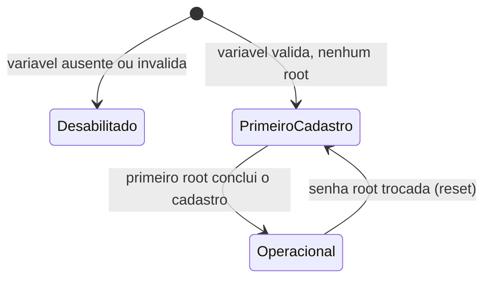
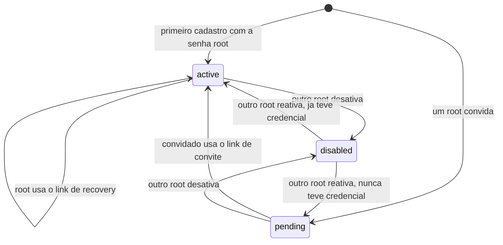
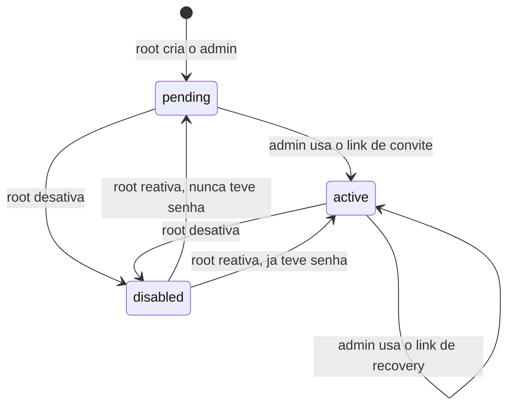

# Standard de Setup de Backoffice — Moljud

**Versão:** 2.0.0

Especificação das páginas, rotas e regras que todo app da Moljud deve seguir para o acesso
de **setup** e para a gestão dos seus **admins**. Este repositório contém somente a
especificação; nenhum código é implementado aqui.

As palavras **DEVE**, **NÃO DEVE**, **DEVERIA** e **PODE** indicam, nesta ordem: obrigação,
proibição, recomendação forte e opção.

## Sumário

1. [Visão geral e escopo](#1-visão-geral-e-escopo)
2. [Glossário](#2-glossário)
3. [Configuração](#3-configuração)
4. [Estado do setup e roots](#4-estado-do-setup-e-roots)
5. [Ciclo de vida do admin](#5-ciclo-de-vida-do-admin)
6. [Páginas](#6-páginas)
7. [API JSON](#7-api-json)
8. [Erros](#8-erros)
9. [Log de auditoria](#9-log-de-auditoria)
10. [Obrigações do app fora do setup](#10-obrigações-do-app-fora-do-setup)
11. [Requisitos de segurança](#11-requisitos-de-segurança)
12. [Fluxos de ponta a ponta](#12-fluxos-de-ponta-a-ponta)
13. [Riscos conhecidos](#13-riscos-conhecidos)
14. [Checklist de conformidade](#14-checklist-de-conformidade)

---

## 1. Visão geral e escopo

Cada app da Moljud implementa este standard por conta própria, com seu próprio banco de
dados. Não existe serviço central de autenticação.

O modelo tem dois níveis:

- O **root** é uma pessoa cadastrada no setup, com nome de usuário, email, senha pessoal e
  MFA próprios. Um app pode ter vários roots, todos com os mesmos poderes. O root não é um
  usuário do app: ele só existe para gerenciar admins e outros roots em `/setup`.
- O **admin** é um usuário de permissão alta dentro do app, criado por um root. É o admin
  quem cria sub-usuários e administra o dia a dia do app.

O **primeiro root** se cadastra sozinho, usando a **senha root**. O ambiente guarda apenas o
hash SHA-256 dessa senha, nunca a senha em si. Assim que o primeiro root conclui o cadastro,
a senha root deixa de dar qualquer acesso. Os demais roots entram por links de convite
gerados por um root já cadastrado.

Trocar a senha root no ambiente **reseta o setup**: todos os roots são apagados e o primeiro
cadastro fica disponível de novo (seção 4.1).

Um admin nunca cria, remove ou promove outro admin. Isso só acontece em `/setup`.

### O que o standard cobre

- A página `/setup` e a API que ela usa.
- O primeiro cadastro, com a senha root.
- Convidar, editar, desativar, reativar e recuperar roots, e o MFA de cada root.
- Criar, editar, desativar e reativar admins.
- Links de convite e de recovery de roots e de admins, e as páginas onde eles são usados.
- O log de auditoria do setup.

### O que fica fora

- A tela de login, o logout e o mecanismo de sessão do app (JWT em cookie, definido por cada
  app).
- Sub-usuários, papéis e permissões.
- MFA de admins e de sub-usuários.
- Envio de email. O standard não envia nada: os links são entregues por fora, por quem os
  gerou.

## 2. Glossário

| Termo | Significado |
| --- | --- |
| **Root** | Pessoa cadastrada no setup, com usuário, email, senha pessoal e MFA. Gerencia admins e outros roots. |
| **Primeiro root** | O root que se cadastra com a senha root. Depois do cadastro, é um root como os outros. |
| **Senha root** | Senha aleatória cujo hash fica no ambiente. Só serve para o primeiro cadastro. |
| **Senha pessoal** | Senha aleatória de cada root, usada junto com o nome de usuário e o código MFA. |
| **Primeiro cadastro** | Estado do setup sem nenhum root, em que a senha root permite cadastrar o primeiro. |
| **Reset** | Volta ao primeiro cadastro, apagando todos os roots. Acontece ao trocar a senha root no ambiente. |
| **Setup** | A página `/setup` e a API `/api/setup/*`, de uso exclusivo dos roots. |
| **Admin** | Usuário de permissão alta do app, criado por um root. |
| **Link de convite** | Link de uso único onde um root ou admin recém-criado define sua credencial. |
| **Link de recovery** | Link de uso único onde um root ou admin existente redefine sua credencial. |
| **Segredo MFA** | Chave TOTP de um root, exibida em texto e como QR code quando ele configura o MFA. |

## 3. Configuração

| Variável | Obrigatória | Regra |
| --- | --- | --- |
| `SETUP_ROOT_PASSWORD_SHA256` | Não | Hash SHA-256 da senha root: exatamente 64 caracteres hexadecimais. |

O ambiente **NÃO DEVE** conter a senha root, só o hash dela. Assim, quem consegue ler as
variáveis de ambiente (painel da cloud, pipeline de deploy, dump de configuração, backup)
não descobre a senha e não consegue entrar no setup.

### 3.1 Gerar a senha e o hash

- A senha root **DEVE** ter no mínimo 32 caracteres, gerados aleatoriamente. O standard não
  limita tentativas de senha; a proteção contra força bruta vem só do tamanho e da
  aleatoriedade. Uma senha de 32 caracteres escolhida por uma pessoa não atende ao standard.
- A senha **DEVE** usar somente letras `A-Z` e `a-z`, dígitos `0-9` e os símbolos
  `+ / = - _ . ~`. Sem espaços, acentos ou outros símbolos: a senha viaja em um header HTTP,
  que não transporta esses caracteres de forma confiável. O `openssl rand -base64` e os
  geradores alfanuméricos já respeitam essa regra.
- Cada app e cada ambiente (produção, staging, preview) **DEVE** ter a sua própria senha
  root. A senha chega em texto ao app que a recebe; se fosse a mesma em todos, um ambiente
  comprometido entregaria o acesso aos demais.
- A senha **DEVERIA** ser gerada na máquina do root, fora da cloud, e guardada em um cofre de
  senhas. Só o hash vai para o ambiente.
- O hash é o SHA-256 dos bytes UTF-8 da senha, exatamente como será digitada, **sem quebra de
  linha no final**, escrito em hexadecimal.

Exemplo de geração:

```bash
SENHA="$(openssl rand -base64 32)"
echo "Senha root (guarde no cofre de senhas): $SENHA"
printf '%s' "$SENHA" | sha256sum | cut -d' ' -f1
```

No macOS, troque `sha256sum` por `shasum -a 256`.

> **Atenção:** `echo "$SENHA" | sha256sum` calcula o hash da senha **com** uma quebra de linha
> no final. O hash fica diferente e a senha correta passa a ser recusada com
> `401 INVALID_CREDENTIALS`. Use sempre `printf '%s'`.

#### Pelo navegador, sem terminal

Quem não quiser usar o terminal pode gerar a senha e o hash no console do próprio navegador.
Nada é enviado a nenhum site: o sorteio e o cálculo acontecem na máquina do root.

1. Abra uma página HTTPS de confiança (por exemplo, a página inicial do próprio app). Em aba
   em branco o comando não funciona, porque o navegador só libera a função de hash em páginas
   HTTPS.
2. Abra o console (F12, aba **Console**), cole o comando abaixo e aperte Enter. Se o navegador
   pedir uma confirmação antes de aceitar texto colado, siga a instrução que ele mostra.

```js
(async () => {
  const bytes = crypto.getRandomValues(new Uint8Array(32));
  const senha = btoa(String.fromCharCode(...bytes));
  const digest = await crypto.subtle.digest('SHA-256', new TextEncoder().encode(senha));
  const hash = Array.from(new Uint8Array(digest), b => b.toString(16).padStart(2, '0')).join('');
  console.log('Senha root (guarde no cofre de senhas):', senha);
  console.log('SETUP_ROOT_PASSWORD_SHA256:', hash);
})();
```

3. Guarde a senha no cofre de senhas, copie o hash para `SETUP_ROOT_PASSWORD_SHA256` e feche a
   aba.

Cuidados:

- O root **NÃO DEVE** colar a senha root em sites de terceiros que calculam hash ou "testam a
  força" da senha. Quem controla a página pode registrá-la.
- Cole no console apenas o comando acima, copiado deste documento. Colar no console comandos
  de origem desconhecida é uma forma comum de golpe.

### 3.2 Como o app usa a variável

- Se a variável estiver ausente, vazia ou não for exatamente 64 caracteres hexadecimais, o
  setup fica **desabilitado**: o app sobe normalmente, a página `/setup` mostra a tela de
  indisponível e toda rota `/api/setup/*` e `/api/root-links/*` responde
  `503 SETUP_DISABLED`. Isso também pega o erro de colocar a senha em texto na variável, no
  lugar do hash.
- O app **DEVE** aceitar o hexadecimal em maiúsculas ou minúsculas e tratá-lo em minúsculas.
- A senha root só é aceita nas rotas do primeiro cadastro (`/api/setup/bootstrap/*`), e só
  enquanto não existe nenhum root. Para verificá-la, o app calcula o SHA-256 da senha
  recebida no header `Authorization` (seção 7.1) e compara, em tempo constante, com o hash
  da variável.
- O app **DEVE** recusar com `401 INVALID_CREDENTIALS` qualquer senha root recebida com menos
  de 32 caracteres ou com caractere fora do alfabeto da seção 3.1, mesmo que o hash confira.
  Como o app não enxerga a senha na variável, este é o único ponto em que essas duas regras
  são impostas por ele.
- Depois que o primeiro root conclui o cadastro, a senha root correta recebe
  `409 BOOTSTRAP_CLOSED` nas rotas do primeiro cadastro e `401 INVALID_CREDENTIALS` nas
  demais. Ela não dá acesso a nada, nem serve para resetar:
  o reset exige trocar o hash na variável (seção 4.1).
- Remover a variável é a forma oficial de desligar o setup em um ambiente. Os roots
  cadastrados não são apagados: se a variável voltar com o mesmo hash, eles voltam a
  funcionar.
- Desabilitar o setup não afeta admins existentes nem links de admin já gerados: as rotas
  `/api/admin-links/*` continuam funcionando.

**Por que SHA-256 simples e não Argon2id ou bcrypt.** Hashes lentos existem para proteger
senhas fracas, escolhidas por pessoas. A senha root é aleatória e tem no mínimo 32
caracteres, então inverter o SHA-256 dela é inviável. Um hash lento, aqui, só deixaria cada
requisição de setup mais cara, e o standard não limita tentativas de senha: qualquer pessoa
na internet poderia usar isso para sobrecarregar o app. O mesmo vale para a senha pessoal
de cada root (seção 4.5).

## 4. Estado do setup e roots

O app **DEVE** persistir, fora da memória do processo:

- o hash da senha root em uso (o valor da variável, em minúsculas);
- o segredo MFA pendente do primeiro cadastro e quantas vezes ele foi exibido;
- os roots e, para cada um: `username`, `email`, status, hash e sal da senha pessoal,
  segredo MFA, contador de códigos MFA errados consecutivos, se está travado e o último
  passo de tempo TOTP aceito;
- os links de root pendentes, com o segredo MFA pendente de cada link e quantas vezes ele
  foi exibido.

As mudanças nesse estado **DEVEM** ser atômicas no armazenamento persistente, para que
requisições simultâneas não contornem as regras:

- **Primeiro cadastro.** Criar o primeiro root é uma única operação condicional: só acontece
  se não existir nenhum root. De duas requisições simultâneas, apenas uma cria o root.
- **Contador e trava.** O app reserva a tentativa antes de comparar o código: soma 1 ao
  contador do root em uma operação atômica, que só acontece se ele estiver abaixo de 10, e
  só então compara. Um acerto zera o contador. Assim, por mais requisições que cheguem ao
  mesmo tempo, nunca são avaliados mais de 10 códigos errados seguidos para o mesmo root.
- **Código de uso único.** Aceitar um código e gravar o último passo aceito do root é uma
  única operação condicional: só grava se o passo for maior que o guardado. De duas
  requisições simultâneas com o mesmo código, apenas uma é aceita.

O armazenamento **DEVE** ter consistência forte e permitir escrita condicional ou transação.
Armazenamentos de consistência eventual (um key-value replicado, por exemplo) não atendem a
este requisito.



| Estado | O que funciona |
| --- | --- |
| **Desabilitado** | Nada do setup. Admins e links de admin seguem funcionando. |
| **Primeiro cadastro** | Só as rotas `/api/setup/bootstrap/*`, com a senha root. |
| **Operacional** | As demais rotas `/api/setup/*`, com a credencial de um root. A senha root não é aceita. |

### 4.1 Reset do setup

Quando o hash da variável não corresponde ao hash guardado, o app **DEVE**, antes de atender
qualquer requisição de `/api/setup/*` ou `/api/root-links/*`:

1. apagar todos os roots, com suas senhas, segredos MFA, contadores e travas;
2. apagar todos os links de root pendentes;
3. descartar o segredo MFA pendente do primeiro cadastro;
4. guardar o novo hash;
5. registrar o evento `setup_reset` na auditoria (`details.roots_removed`).

O setup volta ao estado de **primeiro cadastro**: quem tiver a nova senha root cadastra o
primeiro root.

Admins, links de admin e o log de auditoria **NÃO DEVEM** ser alterados pelo reset.

Trocar a senha root (e, portanto, o hash na variável) é o único jeito de resetar. Não existe
rota de reset, e digitar a senha root atual em `/setup` não reseta nada. Consequência: quem
só conhece a senha root não consegue nada depois do primeiro cadastro; para tomar o setup é
preciso poder **escrever** no ambiente.

### 4.2 MFA dos roots

Cada root tem o seu próprio segredo MFA.

- Padrão TOTP (RFC 6238): SHA-1, 6 dígitos, período de 30 segundos, segredo de 160 bits em
  Base32.
- O app **DEVE** aceitar o código do passo atual e dos passos imediatamente anterior e
  seguinte, para tolerar diferença de relógio.
- **Cada código vale uma única vez.** O app guarda o último passo aceito de cada root e
  rejeita qualquer código de passo igual ou anterior com `409 MFA_CODE_ALREADY_USED`.
  Consequência prática: o root espera um código novo (até 30 segundos) entre uma ação e a
  seguinte.
- **Não existe código de recovery separado.** Quem guardou o segredo consegue cadastrá-lo de
  novo em qualquer autenticador e obter os mesmos códigos. Quem não guardou pede um link de
  recovery a outro root (seção 4.6).
- O segredo só é exibido enquanto o cadastro que o gerou não foi concluído: no primeiro
  cadastro (seção 7.5) ou na página de um link de root (seção 7.19). Depois disso, nenhuma
  rota o devolve.
- Toda exibição do segredo é auditada e contada. A tela mostra quantas vezes o segredo já
  foi exibido, para a pessoa perceber se alguém o viu antes dela.

### 4.3 Trava por erros de MFA

A trava é por root. Não existe trava do setup inteiro.

- O contador do root soma **1** a cada código MFA errado enviado **junto com o usuário e a
  senha pessoal corretos**.
- Um acerto zera o contador.
- Código repetido (`MFA_CODE_ALREADY_USED`) e erros durante um cadastro (primeiro cadastro
  ou página de link) não contam.
- Ao chegar a **10**, o root fica **travado**: toda rota `/api/setup/*` com a credencial
  correta dele responde `423 ROOT_LOCKED`. Os outros roots não são afetados.
- O root destrava quando usa um link de recovery gerado por outro root (seção 4.6). Se não
  houver outro root ativo, a saída é o reset (seção 4.1).
- Não há bloqueio por tempo, por IP ou por número de senhas erradas. Por isso, ninguém
  consegue travar um root só por saber o nome de usuário dele.

Um código errado enviado com a senha pessoal correta significa que alguém além do root pode
ter a senha, e cada acerto do root zera o contador. Para que isso não passe despercebido:

- A cada `mfa_failed` e a cada `root_locked`, o app **DEVE** escrever uma linha de nível
  erro nos seus logs de infraestrutura (sem segredos) e **DEVERIA** disparar o alerta que a
  equipe usa para incidentes.
- O painel **DEVE** avisar o root quando houve códigos errados na conta dele desde o seu
  último acesso (seções 6.1 e 7.7).

### 4.4 Ciclo de vida do root

| Status | Significado |
| --- | --- |
| `pending` | Convidado por outro root, ainda não definiu senha e MFA. |
| `active` | Pode usar o setup (desde que tenha credencial, ver `has_credentials`, e não esteja travado). |
| `disabled` | Desativado por outro root. Não usa o setup. O registro é mantido. |



Regras:

- **Todos os roots têm os mesmos poderes.** Qualquer root `active` gerencia admins e os
  demais roots. O primeiro root não tem privilégio a mais.
- **Ninguém age sobre si mesmo.** Um root não desativa a si mesmo nem gera ou revoga link
  para si mesmo: a resposta é `409 ROOT_SELF_ACTION`. Assim, sempre resta ao menos um root
  que não está desativado.
- **Fora do reset, não há exclusão.** Desativar é a única forma de remover um root. O reset
  (seção 4.1) apaga todos de uma vez.
- `username` e `email` são únicos entre todos os roots, inclusive os `disabled`, sem
  diferenciar maiúsculas de minúsculas. As regras de formato são as mesmas do admin (seção
  5). Roots e contas do app são conjuntos separados: um root pode ter o mesmo `username` ou
  `email` de um admin.
- **Desativar** revoga o link pendente e vale na requisição seguinte: como não há sessão de
  setup, não há o que derrubar. A senha e o segredo MFA guardados são mantidos.
- **Reativar** devolve o root ao status anterior e nenhum link é recriado. Se a desativação
  foi por suspeita de invasão, quem reativa **DEVERIA** gerar um link de recovery logo em
  seguida.
- A trava (seção 4.3) é independente do status: um root `active` pode estar travado.

### 4.5 Senha pessoal do root

- A senha pessoal segue as mesmas regras da senha root (seção 3.1): no mínimo 32 caracteres,
  sorteados, usando somente `A-Z`, `a-z`, `0-9` e `+ / = - _ . ~`.
- As páginas onde a senha é definida (primeiro cadastro, convite e recovery de root)
  **DEVEM** sugerir uma senha já sorteada, gerada no próprio navegador com
  `crypto.getRandomValues`, com botão de copiar e botão de gerar outra, e orientar a pessoa
  a guardá-la em um cofre de senhas. A senha sugerida não é enviada a lugar nenhum antes de
  o formulário ser enviado.
- O campo **PODE** ser editado, mas a API recusa com `422 VALIDATION_ERROR` qualquer senha
  com menos de 32 caracteres ou com caractere fora do alfabeto. Uma senha de 32 caracteres
  escolhida por uma pessoa não atende ao standard.
- O app guarda apenas o SHA-256 de um sal aleatório de no mínimo 16 bytes, próprio de cada
  root, seguido dos bytes UTF-8 da senha. A comparação é em tempo constante.
- Não há hash lento nem limite de tentativas, pelo mesmo motivo da senha root (seção 3.2):
  a proteção vem do tamanho e da aleatoriedade.
- Um root só troca a própria senha por um link de recovery gerado por outro root.

### 4.6 Links de convite e de recovery de root

Seguem as regras dos links de admin (seção 5.1): token de no mínimo 32 bytes guardado apenas
como hash, validade de 24 horas, uso único, token no fragmento da URL, no máximo um link
pendente por root e URL exibida só no momento da geração.

O que muda em relação ao admin:

- As páginas são `/root-invite#{token}` e `/root-recovery#{token}` (seção 6.3).
- Quem usa o link define a senha pessoal **e** configura o MFA. O link só é consumido quando
  os dois estão prontos.
- Root `pending` recebe **convite**; root `active` recebe **recovery**. Root `disabled` não
  recebe link.
- **Gerar um link de recovery invalida imediatamente a senha pessoal e o segredo MFA do
  root.** Até usar o link, ele continua `active` com `has_credentials: false` e não consegue
  usar o setup.
- Usar um link de recovery também zera o contador de erros e remove a trava.
- Revogar um link de recovery **não** restaura a senha nem o MFA antigos.
- Um link de root dá acesso total ao setup a quem o usar. Quem o gera **DEVE** entregá-lo
  por um canal seguro e **DEVERIA** conferir com a pessoa, por outro canal, que foi ela quem
  o usou.

## 5. Ciclo de vida do admin

| Status | Significado |
| --- | --- |
| `pending` | Criado por um root, ainda não definiu a primeira senha. |
| `active` | Pode autenticar no app (desde que tenha senha, ver `has_password`). |
| `disabled` | Desativado por um root. Não autentica. O registro é mantido. |



Regras:

- **Nunca há exclusão.** Desativar é a única forma de remover um admin.
- `username` e `email` são únicos entre todos os admins, inclusive os `disabled`, sem
  diferenciar maiúsculas de minúsculas.
- `username`: de 3 a 32 caracteres, apenas `a-z`, `0-9`, `.`, `_` e `-`.
- `email`: formato de email válido. O standard **não** verifica se o endereço existe ou
  pertence ao admin.
- **Desativar** revoga o link pendente e invalida todas as sessões do admin na hora. A senha
  guardada é mantida.
- **Reativar** devolve o admin ao status anterior. As sessões antigas continuam inválidas e
  nenhum link é recriado. Se a desativação foi por suspeita de invasão, o root **DEVERIA**
  gerar um link de recovery logo após reativar.

### 5.1 Links de convite e de recovery

- O tipo depende do status: admin `pending` recebe **convite**; admin `active` recebe
  **recovery**. Admin `disabled` não recebe link.
- O token **DEVE** ter no mínimo 32 bytes de um gerador criptograficamente seguro, codificado
  em base64url. O app guarda apenas o hash do token.
- Validade de **24 horas** a partir da geração.
- **Uso único**: ao definir a senha, o link é consumido.
- O token vai no **fragmento** da URL (`https://app.exemplo.com/admin-invite#{token}`), nunca
  no caminho nem na query. O navegador não envia o fragmento ao servidor, então o token não
  entra em logs de acesso, proxies, CDN nem no header `Referer`. Nas chamadas à API, o token
  vai no corpo da requisição.
- Cada admin tem no máximo um link pendente. Gerar um novo invalida o anterior.
- A URL completa só aparece na resposta da rota que gerou o link. Não há como consultá-la
  depois.
- **Gerar um link de recovery invalida imediatamente a senha atual e todas as sessões do
  admin.** Até usar o link, ele continua `active` com `has_password: false` e não consegue
  entrar.
- Revogar um link de recovery **não** restaura a senha antiga. O root precisa gerar outro.

## 6. Páginas

Todas as páginas deste standard **DEVEM** ser servidas com estes headers:

| Header | Valor |
| --- | --- |
| `Cache-Control` | `no-store` |
| `Referrer-Policy` | `no-referrer` |
| `X-Robots-Tag` | `noindex` |
| `X-Frame-Options` | `DENY` |
| `Strict-Transport-Security` | `max-age=31536000` ou maior. |
| `Content-Security-Policy` | No mínimo `default-src 'self'; img-src 'self' data:; frame-ancestors 'none'; base-uri 'none'; form-action 'self'`. |

- A política **NÃO DEVE** liberar `'unsafe-inline'` nem `'unsafe-eval'` para scripts. Scripts
  inline do próprio app **PODEM** ser liberados por nonce ou hash.
- `img-src data:` existe para o QR code, que chega como `data:` URI.
- `frame-ancestors 'none'` e `X-Frame-Options` impedem que a página seja aberta dentro de
  outra, para capturar cliques ou a senha.
- Todo valor vindo da API **DEVE** ser exibido como texto, nunca interpretado como HTML. Isso
  vale em especial para o `user_agent` do log de auditoria, que é escrito por quem faz a
  requisição.

### 6.1 `GET /setup`

A página `/setup` **PODE** ser uma SPA (single page application): carregada uma única vez,
ela alterna entre as telas abaixo sem recarregar e conversa com o servidor somente pela API
JSON da seção 7. É esse modo que permite ao root digitar a credencial uma vez e mantê-la em
memória enquanto trabalha.

Não existe sessão de setup: toda requisição leva a credencial (usuário e senha pessoal, ou
a senha root no primeiro cadastro), e toda ação pede um código MFA novo.

- A página **NÃO DEVE** guardar senha root, senha pessoal nem códigos MFA em cookie,
  `localStorage`, `sessionStorage` ou qualquer outro armazenamento do navegador.
- A página **PODE** manter a credencial em memória (uma variável do script) enquanto a aba
  estiver aberta, para o root não precisar colá-la a cada ação. Nesse caso ela **DEVE**
  descartá-la ao recarregar ou fechar a aba e após 5 minutos sem nenhuma ação.
- O código MFA nunca é reaproveitado: a página pede um novo a cada ação.

| Tela | Quando aparece | Conteúdo |
| --- | --- | --- |
| **Indisponível** | API responde `SETUP_DISABLED`. | Aviso de que o setup está desligado neste ambiente. |
| **Entrar** | Estado inicial. | Campos de usuário, senha pessoal e código MFA, e o atalho **Primeiro acesso**. Ao enviar, chama `GET /api/setup/admins`. |
| **Primeiro acesso** | Root escolhe o atalho. | Campo de senha root. Ao enviar, chama `POST /api/setup/bootstrap/enroll`. |
| **Cadastro inicial** | `bootstrap/enroll` responde `200`. | Campos `username` e `email`, senha pessoal sugerida, QR code, segredo em texto, quantas vezes o segredo já foi exibido e campo do código de 6 dígitos. |
| **Já configurado** | API responde `BOOTSTRAP_CLOSED`. | Aviso de que já existe um root, de que a senha root não dá mais acesso e de que resetar exige trocar `SETUP_ROOT_PASSWORD_SHA256` no ambiente. |
| **Conta travada** | API responde `ROOT_LOCKED`. | Aviso de que a conta travou por códigos errados e de que é preciso pedir um link de recovery a outro root. |
| **Painel** | Credencial e código aceitos. | Lista de admins e ações. A lista de roots e o log de auditoria são abertos à parte, a pedido do root. |

A tela **Entrar** é sempre a inicial, exista ou não algum root: a página não consulta o
estado do setup antes de receber uma credencial.

Regras da tela **Cadastro inicial**:

- Aparece imediatamente após a senha root correta, sem passar por nenhuma outra tela.
- A senha pessoal segue a seção 4.5: a página sugere uma senha sorteada, com botão de copiar
  e de gerar outra, e avisa que ela precisa ser guardada em um cofre de senhas.
- **DEVE** avisar que o segredo MFA não será mostrado outra vez.
- Recarregar a página antes de concluir mostra o mesmo QR code e o mesmo segredo. A senha
  sugerida é outra, porque nunca saiu do navegador.
- **DEVE** mostrar o `view_count` devolvido por `bootstrap/enroll`. Se ele for maior que 1,
  a tela avisa que o segredo já foi exibido antes e que, se não foi a própria pessoa
  (recarregando a página, por exemplo), outra pessoa tem a senha root e pode ter copiado o
  segredo: nesse caso a senha root é trocada em vez de o cadastro ser concluído.
- Ao enviar, chama `POST /api/setup/bootstrap/complete`. Com a resposta `201`, a página
  troca a senha root que tinha em memória pela nova credencial e pede um código novo para
  abrir o painel.

Conteúdo do **Painel**:

- Nome de usuário do root que está usando o painel.
- Lista de todos os admins, inclusive `disabled`, com `username`, `email`, status, se tem
  senha e, se houver, tipo e validade do link pendente.
- **Aviso de códigos errados.** Se `mfa_failed_since_last_listing` (seção 7.7) for maior que
  zero, o painel **DEVE** mostrar em destaque quantos códigos MFA errados foram enviados com
  a senha pessoal correta desde o último acesso, e orientar: se não foram do próprio root, a
  senha dele vazou e ele precisa pedir um link de recovery a outro root.
- Formulário de **criar admin**: `username` e `email`.
- Por admin: **editar** nome/email, **desativar** ou **reativar**, **gerar link**, **revogar
  link**.
- **Lista de roots**, carregada quando o root pede, com `username`, `email`, status, se tem
  credencial, se está travado e, se houver, tipo e validade do link pendente. Formulário de
  **convidar root** (`username` e `email`) e, por root, as mesmas ações dos admins. As ações
  sobre o próprio root ficam indisponíveis, exceto editar.
- Ao gerar um link, a URL é exibida uma única vez, com botão de copiar e aviso de que não
  poderá ser vista de novo.
- **Log de auditoria** paginado, carregado somente quando o root pede. Abrir o log e avançar
  cada página são ações: cada uma pede um código MFA novo.
- Toda ação abre um pedido de um código MFA novo (e da credencial, se a página não a tiver
  em memória). Depois de uma ação, a página atualiza a lista com o objeto `admin` ou `root`
  devolvido na resposta, sem listar tudo de novo.

### 6.2 `GET /admin-invite` e `GET /admin-recovery`

Páginas públicas, sem credencial root. As duas têm o mesmo comportamento; muda apenas o texto.
O token chega no fragmento da URL (`/admin-invite#{token}`), que o navegador não envia ao
servidor.

1. A página lê o token do fragmento, guarda-o apenas em memória e o remove da barra de
   endereço (`history.replaceState`).
2. A página chama `POST /api/admin-links/lookup` com o token no corpo.
3. Se não houver fragmento, se a resposta for `LINK_INVALID` ou se o `type` devolvido não
   corresponder ao caminho da página, mostra a tela de **link inválido ou expirado**,
   orientando a pedir um novo link.
4. Caso contrário, mostra `username` e `email` **somente leitura** e os campos **senha** e
   **confirmar senha**.
5. Ao enviar, chama `POST /api/admin-links/use` com o token e a senha no corpo.
6. Em caso de sucesso, redireciona para a página de login do app. O admin **não** sai
   autenticado.

Abrir a página não consome o link: só o envio da senha consome. Assim, pré-visualizadores de
link de aplicativos de mensagem e de email não invalidam o convite.

A confirmação de senha é validada apenas na página; a API recebe um único campo.

### 6.3 `GET /root-invite` e `GET /root-recovery`

Páginas públicas, sem credencial. As duas têm o mesmo comportamento; muda apenas o texto. O
token chega no fragmento da URL, como nas páginas de admin.

1. A página lê o token do fragmento, guarda-o apenas em memória e o remove da barra de
   endereço (`history.replaceState`).
2. A página chama `POST /api/root-links/lookup` com o token no corpo.
3. Se não houver fragmento, se a resposta for `LINK_INVALID` ou se o `type` devolvido não
   corresponder ao caminho da página, mostra a tela de **link inválido ou expirado**,
   orientando a pedir um novo link a um root.
4. Caso contrário, mostra `username` e `email` **somente leitura**, a senha pessoal sugerida
   (seção 4.5) e um botão para **configurar o MFA**.
5. Ao clicar no botão, a página chama `POST /api/root-links/mfa/enroll` e mostra o QR code,
   o segredo em texto, quantas vezes ele já foi exibido e o campo do código de 6 dígitos.
6. Ao enviar, chama `POST /api/root-links/use` com o token, a senha e o código no corpo.
7. Em caso de sucesso, redireciona para `/setup`. O root **não** sai autenticado.

Abrir a página não consome o link nem exibe o segredo: o segredo só é pedido quando a pessoa
clica no botão, e o link só é consumido no envio final. Assim, pré-visualizadores de link de
aplicativos de mensagem e de email não invalidam o convite nem aumentam o contador de
exibições.

Se o `view_count` for maior que 1, a página avisa que o segredo já foi exibido antes e que,
se não foi a própria pessoa, o link foi aberto por outra: nesse caso ela não conclui o
cadastro e pede um link novo.

## 7. API JSON

### 7.1 Convenções

- Corpos de requisição e de resposta em `application/json; charset=utf-8`.
- Datas em ISO 8601, UTC (`2026-11-23T15:28:00Z`).
- Identificadores (`id`) são strings opacas.
- Toda resposta **DEVE** ter `Cache-Control: no-store`.
- Credenciais do setup vão **somente** nestes headers, nunca na URL nem no corpo:

| Header | Conteúdo | Onde vale |
| --- | --- | --- |
| `Authorization` | `Setup <senha root>`: a palavra `Setup`, um espaço e a senha root. | Só nas rotas `/api/setup/bootstrap/*`. |
| `Authorization` | `SetupRoot <username>:<senha pessoal>`: a palavra `SetupRoot`, um espaço, o nome de usuário, dois-pontos e a senha. | Nas demais rotas `/api/setup/*`. |
| `X-Setup-MFA-Code` | Código TOTP de 6 dígitos. | Nas rotas marcadas com **M**. |

O `username` não contém dois-pontos (seção 5), então o app separa usuário e senha no
primeiro `:`. O nome de usuário é comparado sem diferenciar maiúsculas de minúsculas.

A senha vai em `Authorization`, e não em um header próprio, porque ferramentas de log,
monitoramento, CDN e WAF mascaram `Authorization` por padrão; um header próprio só seria
mascarado onde alguém lembrasse de configurar. O código MFA pode ir em header próprio porque
vale uma única vez. O app **NÃO DEVE** responder com `WWW-Authenticate: Basic`, para o
navegador não abrir a janela nativa de usuário e senha.

A única exceção à regra de credenciais fora do corpo é a senha pessoal **no momento em que é
definida**: ela vai no corpo de `bootstrap/complete` e de `root-links/use`, junto com os
outros dados do cadastro.

Na tabela de rotas, **S** é a senha root, **R** é a credencial de um root (usuário e senha
pessoal) e **M** é o código MFA.

| Método | Rota | Credencial | Função |
| --- | --- | --- | --- |
| `POST` | `/api/setup/bootstrap/enroll` | S | Primeiro cadastro: obter segredo e QR code. |
| `POST` | `/api/setup/bootstrap/complete` | S+M | Primeiro cadastro: criar o primeiro root. |
| `GET` | `/api/setup/admins` | R+M | Listar admins. |
| `POST` | `/api/setup/admins` | R+M | Criar admin e link de convite. |
| `PATCH` | `/api/setup/admins/{id}` | R+M | Editar nome/email. |
| `POST` | `/api/setup/admins/{id}/deactivate` | R+M | Desativar. |
| `POST` | `/api/setup/admins/{id}/reactivate` | R+M | Reativar. |
| `POST` | `/api/setup/admins/{id}/link` | R+M | Gerar link de convite ou recovery. |
| `DELETE` | `/api/setup/admins/{id}/link` | R+M | Revogar link pendente. |
| `GET` | `/api/setup/roots` | R+M | Listar roots. |
| `POST` | `/api/setup/roots` | R+M | Convidar root e gerar o link de convite. |
| `PATCH` | `/api/setup/roots/{id}` | R+M | Editar nome/email de um root. |
| `POST` | `/api/setup/roots/{id}/deactivate` | R+M | Desativar root. |
| `POST` | `/api/setup/roots/{id}/reactivate` | R+M | Reativar root. |
| `POST` | `/api/setup/roots/{id}/link` | R+M | Gerar link de convite ou recovery de root. |
| `DELETE` | `/api/setup/roots/{id}/link` | R+M | Revogar link pendente de root. |
| `GET` | `/api/setup/audit-log` | R+M | Consultar auditoria. |
| `POST` | `/api/admin-links/lookup` | Nenhuma | Consultar um link de admin (token no corpo). |
| `POST` | `/api/admin-links/use` | Nenhuma | Definir a senha do admin e consumir o link. |
| `POST` | `/api/root-links/lookup` | Nenhuma | Consultar um link de root (token no corpo). |
| `POST` | `/api/root-links/mfa/enroll` | Nenhuma | Obter segredo e QR code do root do link. |
| `POST` | `/api/root-links/use` | Nenhuma | Definir senha e MFA do root e consumir o link. |

### 7.2 Ordem de verificação das rotas `/api/setup/*`

O app **DEVE** verificar nesta ordem e responder com o primeiro erro encontrado:

| # | Condição | Resposta |
| --- | --- | --- |
| 1 | Setup desabilitado. | `503 SETUP_DISABLED` |
| 2 | Header `Authorization` ausente ou fora dos dois formatos da seção 7.1; esquema que não vale para a rota (`Setup` fora de `bootstrap/*`, ou `SetupRoot` em `bootstrap/*`). | `401 INVALID_CREDENTIALS` |
| 3 | Esquema `Setup`: senha com menos de 32 caracteres, com caractere fora do alfabeto da seção 3.1 ou cujo SHA-256 não confere com a variável. | `401 INVALID_CREDENTIALS` |
| 4 | Esquema `Setup`, senha root correta, e já existe ao menos um root. | `409 BOOTSTRAP_CLOSED` |
| 5 | Esquema `SetupRoot`: usuário inexistente, root `pending`, `disabled` ou com `has_credentials: false`, ou senha pessoal incorreta. | `401 INVALID_CREDENTIALS` |
| 6 | Root travado. | `423 ROOT_LOCKED` |
| 7 | `bootstrap/complete` sem segredo gerado por `bootstrap/enroll`. | `409 MFA_NOT_ENROLLED` |
| 8 | Rota com **M** e header do código ausente. | `401 MFA_REQUIRED` |
| 9 | Código MFA que não tem exatamente 6 dígitos; corpo ou parâmetros em formato inválido. | `422 VALIDATION_ERROR` |
| 10 | Código válido para um passo da janela (seção 4.2) igual ou anterior ao último passo aceito do root. | `409 MFA_CODE_ALREADY_USED` |
| 11 | Código incorreto. | `401 MFA_INVALID_CODE` (soma 1 ao contador do root; no 10º, `423 ROOT_LOCKED`). Em `bootstrap/complete` não soma. |
| 12 | Regras da própria rota. | Erros específicos. |

Pontos importantes:

- Sem uma credencial correta, a resposta é sempre `401 INVALID_CREDENTIALS`. Nada sobre o
  estado do setup, sobre a existência de um usuário ou sobre o status de um root é revelado
  a quem não tem a senha correspondente.
- Todos os casos do item 5 **DEVEM** responder de forma idêntica. Para um usuário
  inexistente, o app **DEVERIA** fazer a mesma comparação de hash com um valor de descarte,
  para o tempo de resposta não revelar quais nomes de usuário existem.
- `BOOTSTRAP_CLOSED` e `ROOT_LOCKED` só são vistos por quem enviou a senha correta.
- A validação de formato (item 9) vem antes da comparação do código para que um erro de
  digitação no formulário não gaste um código. Um código MFA fora do formato de 6 dígitos
  não pode estar certo, então não soma ao contador; o erro vem em `fields.mfa_code`.
- Um código só é marcado como usado quando é aceito (passa pelo item 11).
- Erros do item 12 acontecem depois de o código ser consumido.
- O item 10 não se aplica a `bootstrap/complete`: nesse momento ainda não existe root nem
  último passo aceito.

### 7.3 Objeto `Admin`

```json
{
  "id": "adm_01JD8Z3K",
  "username": "maria.silva",
  "email": "maria@exemplo.com",
  "status": "pending",
  "has_password": false,
  "created_at": "2026-11-23T15:28:00Z",
  "updated_at": "2026-11-23T15:28:00Z",
  "disabled_at": null,
  "link": {
    "type": "invite",
    "expires_at": "2026-11-24T15:28:00Z"
  }
}
```

- `status`: `pending`, `active` ou `disabled`.
- `link`: `null` quando não há link pendente e válido. `type` é `invite` ou `recovery`.
- `link.url` só existe nas respostas de `POST /api/setup/admins` e
  `POST /api/setup/admins/{id}/link`.
- A senha e seu hash nunca aparecem em nenhuma resposta.

### 7.4 Objeto `Root`

```json
{
  "id": "root_01JD8Z1A",
  "username": "joao.souza",
  "email": "joao@exemplo.com",
  "status": "active",
  "has_credentials": true,
  "locked": false,
  "created_at": "2026-11-23T15:20:00Z",
  "updated_at": "2026-11-23T15:20:00Z",
  "disabled_at": null,
  "link": null
}
```

- `status`: `pending`, `active` ou `disabled` (seção 4.4).
- `has_credentials`: `true` quando o root tem senha pessoal e MFA definidos. Fica `false`
  antes do convite ser usado e entre a geração e o uso de um link de recovery.
- `locked`: `true` quando o root travou por códigos errados (seção 4.3).
- `link`: `null` quando não há link pendente e válido; caso contrário, `type` (`invite` ou
  `recovery`) e `expires_at`.
- `link.url` só existe nas respostas de `POST /api/setup/roots` e
  `POST /api/setup/roots/{id}/link`.
- A senha, seu hash e o segredo MFA nunca aparecem neste objeto.

### 7.5 `POST /api/setup/bootstrap/enroll`

Primeiro passo do primeiro cadastro. Devolve o segredo MFA pendente do primeiro root. Na
primeira chamada o segredo é gerado; chamadas seguintes, enquanto o cadastro não for
concluído, devolvem **o mesmo** segredo. Sem corpo.

Cada chamada bem-sucedida soma 1 ao `view_count` do segredo e registra
`bootstrap_secret_viewed` na auditoria.

Resposta `200`:

```json
{
  "secret": "JBSWY3DPEHPK3PXPJBSWY3DPEHPK3PXP",
  "otpauth_uri": "otpauth://totp/NomeDoApp:setup?secret=JBSWY3DPEHPK3PXPJBSWY3DPEHPK3PXP&issuer=NomeDoApp&algorithm=SHA1&digits=6&period=30",
  "qr_code": "data:image/png;base64,iVBORw0KGgo...",
  "view_count": 1
}
```

- `issuer` é o nome do app. A conta é `setup` no primeiro cadastro, porque o `username`
  ainda não foi escolhido; nos links de root (seção 7.19), é o `username` do root.
- `qr_code` é a imagem do `otpauth_uri`, gerada pelo próprio app. O segredo **NÃO DEVE** ser
  enviado a nenhum serviço externo de geração de QR code.
- `view_count` é quantas vezes este segredo já foi devolvido, contando a chamada atual. Volta
  a zero quando o segredo é descartado (seção 4.1).

Erros: `409 BOOTSTRAP_CLOSED` se já existe um root.

### 7.6 `POST /api/setup/bootstrap/complete`

Cria o primeiro root. O código do autenticador vai no header `X-Setup-MFA-Code`.

Corpo:

```json
{
  "username": "joao.souza",
  "email": "joao@exemplo.com",
  "password": "kq3Zr8mN1xT5vB7yLp2Wd9Hs4Jf6Gc0AeUoIiRtYnM="
}
```

- `username` e `email` seguem as regras da seção 5; `password` segue a seção 4.5.

Efeitos, de forma atômica e **somente se não existir nenhum root**:

1. cria o root com status `active`, o hash da senha e o segredo MFA do `bootstrap/enroll`;
2. grava o passo do código aceito como último passo aceito do root;
3. descarta o segredo pendente do primeiro cadastro;
4. registra `root_bootstrapped` na auditoria.

Resposta `201`: `{ "root": { ... } }`. A partir daqui o segredo não é mais exibido e a
senha root deixa de ser aceita.

Erros:

- `409 BOOTSTRAP_CLOSED` se já existe um root, inclusive quando outra requisição simultânea
  criou o primeiro.
- `409 MFA_NOT_ENROLLED` se `bootstrap/enroll` ainda não foi chamado.
- `422 VALIDATION_ERROR` para `username`, `email`, `password` ou código fora do formato.
- `401 MFA_INVALID_CODE` para código errado. **Não** soma a nenhum contador: nessa fase,
  quem tem a senha root já consegue ver o segredo.

### 7.7 `GET /api/setup/admins`

Lista todos os admins, inclusive `disabled`, ordenados por `created_at`. Sem paginação.

Resposta `200`:

```json
{
  "mfa_failed_since_last_listing": 0,
  "admins": [ { "id": "adm_01JD8Z3K", "username": "maria.silva", "...": "..." } ]
}
```

`mfa_failed_since_last_listing` é por root: a quantidade de eventos `mfa_failed` da conta de
quem fez a requisição, registrados depois da listagem anterior feita por ele (evento
`admins_listed` com ele como `actor`) ou, na primeira listagem, depois de ele ter definido a
credencial (`root_bootstrapped` ou `root_link_used`). Quem tem só a senha pessoal não
consegue listar, então não consegue zerar esse número.

### 7.8 `POST /api/setup/admins`

Cria um admin `pending` e já gera seu link de convite.

Corpo:

```json
{ "username": "maria.silva", "email": "maria@exemplo.com" }
```

Resposta `201`:

```json
{
  "admin": {
    "id": "adm_01JD8Z3K",
    "username": "maria.silva",
    "email": "maria@exemplo.com",
    "status": "pending",
    "has_password": false,
    "created_at": "2026-11-23T15:28:00Z",
    "updated_at": "2026-11-23T15:28:00Z",
    "disabled_at": null,
    "link": {
      "type": "invite",
      "expires_at": "2026-11-24T15:28:00Z",
      "url": "https://app.exemplo.com/admin-invite#3q2-7wAAAAECAwQFBgcICQoLDA0ODxAREhMUFRYXGBk"
    }
  }
}
```

Erros: `422 VALIDATION_ERROR`; `409 ADMIN_CONFLICT` se `username` ou `email` já existem em
outro admin ou em qualquer outra conta que entra pelo mesmo login (seção 10, item 5).

### 7.9 `PATCH /api/setup/admins/{id}`

Altera `username`, `email` ou ambos. Permitido em qualquer status. Não afeta senha, sessões
nem links.

Corpo (ao menos um campo):

```json
{ "email": "maria.silva@exemplo.com" }
```

Resposta `200`: `{ "admin": { ... } }`.

Erros: `404 ADMIN_NOT_FOUND`; `422 VALIDATION_ERROR`; `409 ADMIN_CONFLICT`.

### 7.10 `POST /api/setup/admins/{id}/deactivate`

Muda o status para `disabled`, revoga o link pendente e invalida todas as sessões do admin
imediatamente. Sem corpo.

Resposta `200`: `{ "admin": { ... } }`.

Erros: `404 ADMIN_NOT_FOUND`; `409 ADMIN_INVALID_STATE` se já está `disabled`.

### 7.11 `POST /api/setup/admins/{id}/reactivate`

Devolve o admin ao status que tinha antes de ser desativado. Sem corpo.

Resposta `200`: `{ "admin": { ... } }`.

Erros: `404 ADMIN_NOT_FOUND`; `409 ADMIN_INVALID_STATE` se não está `disabled`.

### 7.12 `POST /api/setup/admins/{id}/link`

Gera um link novo e invalida o anterior, se houver. Sem corpo.

- Admin `pending`: link de **convite**.
- Admin `active`: link de **recovery**. A senha atual e todas as sessões são invalidadas na
  hora (`has_password` passa a `false`).

Resposta `201`: `{ "admin": { ... } }`, com `link.url` preenchido.

Erros: `404 ADMIN_NOT_FOUND`; `409 ADMIN_INVALID_STATE` se o admin está `disabled`.

### 7.13 `DELETE /api/setup/admins/{id}/link`

Revoga o link pendente. Não restaura senha invalidada por um recovery.

Resposta `200`: `{ "admin": { ... } }`, com `link: null`.

Erros: `404 ADMIN_NOT_FOUND`; `409 ADMIN_INVALID_STATE` se não há link pendente.

### 7.14 `GET /api/setup/audit-log`

Parâmetros de query:

| Parâmetro | Padrão | Regra |
| --- | --- | --- |
| `limit` | `50` | De 1 a 200. |
| `cursor` | — | Valor de `next_cursor` da página anterior. |

Resposta `200`, do evento mais recente para o mais antigo:

```json
{
  "items": [
    {
      "id": "evt_01JD8Z9P",
      "occurred_at": "2026-11-23T15:30:12Z",
      "event": "admin_created",
      "actor": { "root_id": "root_01JD8Z1A", "username": "joao.souza" },
      "root_id": null,
      "admin_id": "adm_01JD8Z3K",
      "ip": "203.0.113.7",
      "user_agent": "Mozilla/5.0 ...",
      "details": { "username": "maria.silva", "email": "maria@exemplo.com" }
    }
  ],
  "next_cursor": null
}
```

### 7.15 `POST /api/admin-links/lookup`

Pública. Devolve os dados necessários para montar a página do link. Não altera nada: o
método é `POST` apenas para o token ir no corpo, fora da URL.

Corpo:

```json
{ "token": "3q2-7wAAAAECAwQFBgcICQoLDA0ODxAREhMUFRYXGBk" }
```

Resposta `200`:

```json
{
  "type": "invite",
  "username": "maria.silva",
  "email": "maria@exemplo.com",
  "expires_at": "2026-11-24T15:28:00Z"
}
```

Erros: `404 LINK_INVALID` para token ausente, malformado, inexistente, expirado, já usado,
revogado ou de admin `disabled`. Todos os casos respondem de forma idêntica.

### 7.16 `POST /api/admin-links/use`

Pública. Define a senha do admin e consome o link.

Corpo:

```json
{
  "token": "3q2-7wAAAAECAwQFBgcICQoLDA0ODxAREhMUFRYXGBk",
  "password": "uma senha longa e pessoal"
}
```

Regras da senha:

- De 12 a 128 caracteres. Em apps que guardam a senha com bcrypt, o limite superior é de 72
  bytes em UTF-8 (seção 11).
- O app **DEVERIA** recusar senhas que constem em listas de senhas comuns ou vazadas.

O app verifica o token **antes** de validar a senha e só calcula o hash da senha para um
link válido. Assim, quem não tem um link não consegue fazer o app gastar processamento com
o hash lento.

Efeitos, de forma atômica:

1. grava o hash da senha (seção 11);
2. muda o status para `active`;
3. consome o link;
4. invalida todas as sessões existentes do admin;
5. registra `link_used` na auditoria.

Resposta `204`, sem corpo e **sem** cookie de sessão.

Erros: `404 LINK_INVALID`; `422 VALIDATION_ERROR`.

### 7.17 Rotas `/api/setup/roots`

Têm a mesma forma das rotas de admin (seções 7.7 a 7.13), trocando o objeto `Admin` pelo
objeto `Root` (seção 7.4) e a chave `admin` por `root` nas respostas.

| Rota | Comportamento | Erros próprios |
| --- | --- | --- |
| `GET /api/setup/roots` | Lista todos os roots, inclusive `disabled`, por `created_at`. Resposta `200`: `{ "roots": [ ... ] }`. | — |
| `POST /api/setup/roots` | Corpo `{ "username", "email" }`. Cria um root `pending` e já gera o link de convite. Resposta `201`, com `link.url`. | `422 VALIDATION_ERROR`; `409 ROOT_CONFLICT` |
| `PATCH /api/setup/roots/{id}` | Altera `username`, `email` ou ambos, em qualquer status. Não afeta senha, MFA nem links. Um root **PODE** editar a si mesmo. | `404 ROOT_NOT_FOUND`; `422 VALIDATION_ERROR`; `409 ROOT_CONFLICT` |
| `POST /api/setup/roots/{id}/deactivate` | Muda o status para `disabled` e revoga o link pendente. | `404 ROOT_NOT_FOUND`; `409 ROOT_SELF_ACTION`; `409 ROOT_INVALID_STATE` se já está `disabled` |
| `POST /api/setup/roots/{id}/reactivate` | Devolve o root ao status anterior. | `404 ROOT_NOT_FOUND`; `409 ROOT_INVALID_STATE` se não está `disabled` |
| `POST /api/setup/roots/{id}/link` | Gera um link novo e invalida o anterior. Root `pending`: convite. Root `active`: recovery, que invalida na hora a senha e o segredo MFA (`has_credentials` passa a `false`). Resposta `201`, com `link.url`. | `404 ROOT_NOT_FOUND`; `409 ROOT_SELF_ACTION`; `409 ROOT_INVALID_STATE` se está `disabled` |
| `DELETE /api/setup/roots/{id}/link` | Revoga o link pendente. Não restaura senha nem MFA invalidados por um recovery. | `404 ROOT_NOT_FOUND`; `409 ROOT_SELF_ACTION`; `409 ROOT_INVALID_STATE` se não há link pendente |

- `ROOT_SELF_ACTION` é respondido quando o `{id}` é o do root que fez a requisição.
- Um root que edita o próprio `username` passa a usar o novo nome na credencial já na
  requisição seguinte; a página atualiza o valor que tem em memória.
- `ROOT_CONFLICT` considera apenas outros roots (seção 4.4).

### 7.18 `POST /api/root-links/lookup`

Pública. Igual a `POST /api/admin-links/lookup` (seção 7.15), para links de root. Não altera
nada e **não** devolve o segredo MFA.

Resposta `200`:

```json
{
  "type": "invite",
  "username": "ana.lima",
  "email": "ana@exemplo.com",
  "expires_at": "2026-11-24T15:28:00Z"
}
```

Erros: `404 LINK_INVALID` para token ausente, malformado, inexistente, expirado, já usado,
revogado ou de root `disabled`. Todos os casos respondem de forma idêntica.

### 7.19 `POST /api/root-links/mfa/enroll`

Pública. Devolve o segredo MFA pendente do root dono do link. Na primeira chamada o segredo
é gerado; chamadas seguintes com o mesmo link devolvem **o mesmo** segredo.

Corpo: `{ "token": "..." }`.

Resposta `200`: mesmo formato da seção 7.5, com o `username` do root como conta no
`otpauth_uri`.

Cada chamada bem-sucedida soma 1 ao `view_count` e registra `root_mfa_secret_viewed` na
auditoria. O segredo pendente pertence ao link: se o link for revogado, substituído ou
expirar, o segredo é descartado.

Erros: `404 LINK_INVALID`.

### 7.20 `POST /api/root-links/use`

Pública. Define a senha pessoal e o MFA do root e consome o link.

Corpo:

```json
{
  "token": "3q2-7wAAAAECAwQFBgcICQoLDA0ODxAREhMUFRYXGBk",
  "password": "Xp7Lw2Qe9Rt4Yu1Io6As3Df8Gh5Jk0ZxCvBnMmNbVc=",
  "mfa_code": "123456"
}
```

O app verifica nesta ordem:

| # | Condição | Resposta |
| --- | --- | --- |
| 1 | Token inválido (mesmos casos da seção 7.18). | `404 LINK_INVALID` |
| 2 | `mfa/enroll` ainda não foi chamado para este link. | `409 MFA_NOT_ENROLLED` |
| 3 | `password` fora das regras da seção 4.5; `mfa_code` que não tem 6 dígitos. | `422 VALIDATION_ERROR` |
| 4 | Código incorreto para o segredo pendente. | `401 MFA_INVALID_CODE` |

Um código errado **não** consome o link nem soma a nenhum contador: quem tem o token já
consegue ver o segredo.

Efeitos, de forma atômica:

1. grava o hash da senha pessoal (seção 4.5) e o segredo MFA, agora confirmado;
2. grava o passo do código aceito como último passo aceito do root;
3. muda o status para `active`, zera o contador de erros e remove a trava;
4. consome o link;
5. registra `root_link_used` na auditoria.

Resposta `204`, sem corpo.

## 8. Erros

Toda resposta de erro tem este formato:

```json
{
  "error": {
    "code": "VALIDATION_ERROR",
    "message": "Dados inválidos.",
    "fields": { "username": "Use de 3 a 32 caracteres: a-z, 0-9, ponto, _ e -." }
  }
}
```

- `code` é estável e é o que clientes devem tratar.
- `message` é texto para pessoas e pode variar entre apps.
- `fields` só aparece em `VALIDATION_ERROR`.

| Código | HTTP | Quando |
| --- | --- | --- |
| `SETUP_DISABLED` | 503 | `SETUP_ROOT_PASSWORD_SHA256` ausente ou fora do formato de 64 caracteres hexadecimais. |
| `INVALID_CREDENTIALS` | 401 | Header `Authorization` ausente, fora do formato ou com esquema que não vale para a rota; senha root curta, com caractere não permitido ou incorreta; usuário inexistente ou que não pode usar o setup; senha pessoal incorreta. |
| `BOOTSTRAP_CLOSED` | 409 | Senha root correta, mas já existe um root. Resetar exige trocar a senha root no ambiente. |
| `ROOT_LOCKED` | 423 | 10 códigos MFA errados seguidos na conta do root; exige link de recovery gerado por outro root. |
| `MFA_NOT_ENROLLED` | 409 | `bootstrap/complete` ou `root-links/use` antes de o segredo ser obtido pela rota de `enroll` correspondente. |
| `MFA_REQUIRED` | 401 | Header `X-Setup-MFA-Code` ausente. |
| `MFA_INVALID_CODE` | 401 | Código MFA incorreto. |
| `MFA_CODE_ALREADY_USED` | 409 | Código de um passo de tempo já aceito. Aguardar o próximo. |
| `VALIDATION_ERROR` | 422 | Corpo ou parâmetros inválidos, inclusive código MFA que não tem 6 dígitos e senha pessoal fora das regras. |
| `ROOT_NOT_FOUND` | 404 | Não existe root com o `id` informado. |
| `ROOT_CONFLICT` | 409 | `username` ou `email` já usados por outro root. |
| `ROOT_INVALID_STATE` | 409 | A ação não se aplica ao status atual do root. |
| `ROOT_SELF_ACTION` | 409 | O root tentou desativar a si mesmo, ou gerar ou revogar link para si mesmo. |
| `ADMIN_NOT_FOUND` | 404 | Não existe admin com o `id` informado. |
| `ADMIN_CONFLICT` | 409 | `username` ou `email` já usados por outro admin ou por outra conta do mesmo login. |
| `ADMIN_INVALID_STATE` | 409 | A ação não se aplica ao status atual do admin. |
| `LINK_INVALID` | 404 | Token ausente, malformado, inexistente, expirado, usado, revogado ou de conta desativada. |

## 9. Log de auditoria

O app **DEVE** registrar os eventos abaixo. O log é somente de acréscimo: nenhuma rota edita
ou apaga registros, e ele sobrevive ao reset do setup.

A coluna **Alvo** diz qual campo identifica a conta afetada.

| Evento | Quando | Alvo |
| --- | --- | --- |
| `setup_reset` | App detecta senha root diferente da guardada e apaga os roots (`details.roots_removed`). | — |
| `bootstrap_secret_viewed` | Segredo devolvido por `bootstrap/enroll` (`details.view_count`). | — |
| `root_bootstrapped` | Primeiro root criado com a senha root. | `root_id` |
| `mfa_failed` | Código MFA errado com usuário e senha pessoal corretos. | `root_id` |
| `root_locked` | Contador do root chegou a 10. | `root_id` |
| `admins_listed` | Listagem de admins. | — |
| `roots_listed` | Listagem de roots. | — |
| `root_created` | Root convidado. | `root_id` |
| `root_updated` | Nome ou email de root alterado (`details` traz valores antigos e novos). | `root_id` |
| `root_deactivated` | Root desativado. | `root_id` |
| `root_reactivated` | Root reativado. | `root_id` |
| `root_link_generated` | Link de root gerado (`details.type`). | `root_id` |
| `root_link_revoked` | Link de root revogado. | `root_id` |
| `root_mfa_secret_viewed` | Segredo devolvido por `root-links/mfa/enroll` (`details.view_count`). | `root_id` |
| `root_link_used` | Root definiu senha e MFA pelo link (`details.type`). | `root_id` |
| `admin_created` | Admin criado. | `admin_id` |
| `admin_updated` | Nome ou email alterado (`details` traz valores antigos e novos). | `admin_id` |
| `admin_deactivated` | Admin desativado. | `admin_id` |
| `admin_reactivated` | Admin reativado. | `admin_id` |
| `link_generated` | Link de admin gerado (`details.type`). | `admin_id` |
| `link_revoked` | Link de admin revogado. | `admin_id` |
| `link_used` | Admin definiu a senha pelo link (`details.type`). | `admin_id` |

Campos de cada registro: `id`, `occurred_at`, `event`, `actor`, `root_id` (ou `null`),
`admin_id` (ou `null`), `ip`, `user_agent` e `details`.

- `actor` diz **quem fez** a ação: `{ "root_id": "...", "username": "..." }`, com o nome de
  usuário que o root tinha naquele momento. É `null` quando não há root autenticado: no
  primeiro cadastro, no reset e nas rotas públicas de link.
- `root_id` e `admin_id` dizem **quem sofreu** a ação.
- O reset apaga os roots, mas não o log. Depois dele, um `root_id` do log pode não existir
  mais; o `username` guardado em `actor` e em `details` é o que identifica a pessoa. Todo
  evento com alvo `root_id` **DEVE** trazer o `username` do root afetado em
  `details.username`.

O log **NÃO DEVE** conter senha root, senhas pessoais, códigos MFA, segredos MFA, tokens de
link, URLs de link nem senhas de admin.

Tentativas com credencial errada (senha root, usuário ou senha pessoal) não entram neste
log, porque qualquer pessoa na internet conseguiria enchê-lo. O app **PODE** registrá-las
nos seus logs de infraestrutura.

**Valores vindos da requisição.** `ip` e `user_agent` são escritos por quem faz a requisição
e **DEVEM** ser tratados como texto não confiável: o `user_agent` é cortado em 512 caracteres
ao gravar e exibido sempre como texto, nunca como HTML (seção 6).

**Retenção.** O log guarda dados pessoais (nome de usuário, email, IP, navegador). Cada app
**DEVE** definir e documentar por quanto tempo guarda os registros. Passado o prazo, os
registros **PODEM** ser apagados por uma rotina interna do app; continua não existindo rota
que edite ou apague o log.

## 10. Obrigações do app fora do setup

Mesmo com login e sessão fora do escopo, o app **DEVE** garantir:

1. **Revogação imediata.** Em toda requisição autenticada de um admin, o app confere que ele
   está `active` e que a sessão não foi invalidada. Um JWT ainda dentro da validade não basta.
   Uma forma de fazer: guardar no admin um instante `sessions_valid_after` e rejeitar tokens
   emitidos antes dele.
2. **Sem gestão de admins por dentro do app.** Nenhuma tela ou rota fora de `/api/setup/*`
   cria, desativa, reativa ou edita admins, nem promove um sub-usuário a admin.
3. **Login só para `active` com senha.** Admins `pending`, `disabled` ou com
   `has_password: false` não autenticam.
4. **Sem atalho para a senha.** Qualquer fluxo de "esqueci minha senha" que o app ofereça a
   admins não pode contornar o link de recovery gerado por um root.
5. **Sem colisão de identificadores de login.** Se admins e outras contas (sub-usuários)
   entram pelo mesmo login, o `username` e o `email` de um admin **DEVEM** ser únicos também
   em relação a essas contas. Criar ou editar um admin com um identificador já usado responde
   `409 ADMIN_CONFLICT`, e o app não deixa outra conta passar a usar o `username` ou o `email`
   de um admin, inclusive `disabled`.
6. **Limite de tentativas no login.** O login de admins **DEVE** limitar tentativas de senha
   (por conta e por origem). O admin é a conta de maior poder no dia a dia e, neste standard,
   é protegido apenas por uma senha escolhida por uma pessoa.
7. **MFA de admins.** O formato fica fora do escopo, mas o app **DEVERIA** exigir um segundo
   fator dos admins.
8. **Root não é conta do app.** A credencial de um root só vale em `/api/setup/*`. Ela não
   autentica no login do app, e nenhuma tela ou rota fora do setup cria, edita ou lista roots.

## 11. Requisitos de segurança

- Todas as páginas e rotas deste standard **DEVEM** ser servidas apenas por HTTPS.
- Os hashes da senha root e das senhas pessoais e os códigos MFA **DEVEM** ser comparados em
  tempo constante.
- A senha root em texto **NÃO DEVE** ser guardada em variável de ambiente, banco, arquivo de
  configuração ou cofre de segredos da cloud. O app só conhece o hash.
- Senhas pessoais de root **DEVEM** ser guardadas apenas como SHA-256 com sal por root
  (seção 4.5). Elas não usam hash lento porque são aleatórias e têm no mínimo 32 caracteres.
- Senha root, senhas pessoais, códigos MFA, segredos MFA, tokens e senhas de admin **NÃO
  DEVEM** aparecer em logs, em nenhuma URL enviada ao servidor (caminho ou query), em
  mensagens de erro ou em ferramentas de monitoramento. O token de link só existe no
  fragmento da URL e no corpo das chamadas a `/api/admin-links/*` e `/api/root-links/*`.
- O header `Authorization` das rotas de setup, nos dois esquemas, e o header
  `X-Setup-MFA-Code` **DEVEM** ser removidos de qualquer log de requisição, inclusive em
  proxies e balanceadores sob controle da Moljud. O corpo das chamadas a
  `/api/admin-links/*`, a `/api/root-links/*` e a `/api/setup/bootstrap/complete` também
  **NÃO DEVE** ser registrado: ele leva tokens e senhas.
- Os segredos MFA **DEVERIAM** ser guardados cifrados no banco.
- Senhas de admin **DEVEM** ser guardadas com Argon2id, scrypt ou PBKDF2-HMAC-SHA256. O app
  **DEVERIA** usar Argon2id ou scrypt sempre que a plataforma os ofereça de forma nativa.
- O PBKDF2-HMAC-SHA256 existe para plataformas sem Argon2id nem scrypt nativos e com limite
  curto de processamento por requisição, como o plano gratuito do Cloudflare Workers. Quando
  usado, o app **DEVE** gerar um sal aleatório de no mínimo 16 bytes para cada senha, usar no
  mínimo 100.000 iterações e guardar o número de iterações junto do hash, para poder
  aumentá-lo depois sem invalidar as senhas existentes. O app que usa PBKDF2 **DEVE** cumprir
  o limite de tentativas de login da seção 10.
- O bcrypt ignora o que passa de 72 bytes; ele só **PODE** ser usado se o app recusar, com
  `422 VALIDATION_ERROR`, senhas com mais de 72 bytes em UTF-8.
- Tokens de link são guardados apenas como hash (SHA-256 é suficiente, dado o tamanho).
- As rotas `/api/setup/*` e `/api/root-links/*` **NÃO DEVEM** aceitar requisições de outras
  origens (sem CORS liberado).
- As páginas deste standard **NÃO DEVEM** carregar scripts de terceiros e **DEVEM** enviar os
  headers da seção 6.
- A criação do primeiro root e as mudanças no contador de erros e no último passo aceito
  **DEVEM** ser atômicas (seção 4).

## 12. Fluxos de ponta a ponta

### 12.1 Primeiro setup

1. Quem vai ser o primeiro root gera a senha root e o hash (seção 3.1), a equipe define
   `SETUP_ROOT_PASSWORD_SHA256` com o hash e sobe o app.
2. O primeiro root abre `/setup`, escolhe **Primeiro acesso** e informa a senha root →
   `POST /api/setup/bootstrap/enroll` devolve o segredo MFA.
3. A página mostra o cadastro inicial. O root confere que o segredo aparece como exibido uma
   única vez, preenche `username` e `email`, guarda no cofre a senha pessoal sugerida e lê o
   QR code no autenticador.
4. O root digita o código → `POST /api/setup/bootstrap/complete` → `201`.
5. A senha root deixa de ser aceita. Ela não precisa mais ser guardada: para resetar, gera-se
   uma senha nova.
6. O root informa um novo código → `GET /api/setup/admins` → painel.

### 12.2 Criar um admin

1. No painel, o root preenche `username` e `email`, informa um código novo →
   `POST /api/setup/admins`.
2. A página mostra a URL de convite uma única vez. O root copia e envia ao admin por um canal
   seguro.
3. O admin abre `/admin-invite#{token}`, confere nome e email, define a senha →
   `POST /api/admin-links/use`.
4. O admin é levado ao login do app e entra com a nova senha.

### 12.3 Recuperar um admin

1. O root clica em **gerar link** no admin → `POST /api/setup/admins/{id}/link`.
2. A senha antiga e as sessões do admin deixam de valer imediatamente.
3. O root entrega a URL de recovery. O admin abre `/admin-recovery#{token}` e define a nova
   senha.

### 12.4 Root perdeu a senha pessoal ou o autenticador

- **Perdeu o autenticador, mas tem o segredo guardado:** cadastra o mesmo segredo em outro
  autenticador. Nada muda no app.
- **Existe outro root ativo:** ele gera um link de recovery →
  `POST /api/setup/roots/{id}/link`. A senha e o MFA antigos deixam de valer na hora. O root
  abre `/root-recovery#{token}`, define a nova senha e configura o MFA de novo.
- **Não existe outro root ativo:** a saída é o reset (fluxo 12.9).

### 12.5 Root travado

1. Após 10 códigos errados seguidos, toda requisição com a credencial daquele root responde
   `423 ROOT_LOCKED`. Os outros roots continuam trabalhando.
2. Como a trava só é alcançada por quem tem a senha pessoal correta, ela indica senha vazada
   ou autenticador errado. Nos dois casos a saída é a mesma: outro root gera um link de
   recovery (fluxo 12.4), que troca a senha e o MFA e remove a trava.
3. Se não existe outro root ativo, a saída é o reset (fluxo 12.9).

### 12.6 Entrada e saída de roots

**Entrada.** Um root convida o outro:

1. No painel, abre a lista de roots, preenche `username` e `email` do convidado e informa um
   código novo → `POST /api/setup/roots`.
2. A página mostra a URL de convite uma única vez. O root a entrega por um canal seguro.
3. O convidado abre `/root-invite#{token}`, confere nome e email, guarda a senha sugerida no
   cofre, configura o MFA e envia → `POST /api/root-links/use`.
4. O convidado é levado a `/setup` e entra com usuário, senha e um código novo.
5. Quem convidou confere com o convidado, por outro canal, que foi ele quem usou o link.

**Saída.** Quando alguém deixa a função, outro root o desativa →
`POST /api/setup/roots/{id}/deactivate`. O acesso acaba na requisição seguinte. Não é preciso
trocar a senha root nem mexer nos outros roots.

### 12.7 Códigos MFA errados que não foram do root

1. O painel avisa o root de que houve códigos errados na conta dele desde o último acesso,
   ou a equipe recebe o alerta de `mfa_failed`.
2. Se o root não reconhece as tentativas, alguém tem a senha pessoal dele. Ele pede a outro
   root um link de recovery, sem esperar a trava.
3. Um root confere no log de auditoria se houve ação que o dono da conta não fez.

### 12.8 Root comprometido

Quando há suspeita de que alguém de fora controla a conta de um root:

1. Outro root desativa a conta suspeita.
2. Confere no log de auditoria, pelo `actor`, o que a conta fez: roots convidados, links
   gerados, admins criados ou alterados.
3. Desativa o que não reconhecer e revoga os links pendentes.
4. Se não há como saber em qual root confiar, a saída é o reset (fluxo 12.9).

### 12.9 Reset do setup

1. Quem vai ser o novo primeiro root gera uma nova senha root (seção 3.1), e a equipe troca
   `SETUP_ROOT_PASSWORD_SHA256` e reinicia o app.
2. O app apaga todos os roots e seus links e registra `setup_reset`. Admins, links de admin
   e auditoria não mudam.
3. O fluxo 12.1 recomeça do passo 2. Os demais roots precisam ser convidados de novo.

## 13. Riscos conhecidos

Estas são consequências aceitas do desenho. Quem implementa e quem opera precisa conhecê-las.

- **As senhas são a única barreira contra força bruta.** Não há limite de tentativas nem
  para a senha root nem para as senhas pessoais. Se uma delas não for realmente aleatória,
  o setup fica exposto.
- **A sugestão de senha pode ser ignorada.** O app confere o tamanho e o alfabeto da senha
  pessoal, mas não tem como saber se ela foi sorteada. Um root que digitar 32 caracteres
  previsíveis fica sem proteção contra força bruta e, em um vazamento do banco, o SHA-256
  da senha dele pode ser quebrado. O MFA continua sendo a segunda barreira.
- **Senha de 32 caracteres não se decora.** Cada root depende de um cofre de senhas. Quem
  perde a senha depende de outro root, ou do reset.
- **Janela do primeiro cadastro.** Entre subir o app (ou resetar) e concluir o primeiro
  cadastro, a senha root sozinha basta para criar o primeiro root. O cadastro **DEVERIA**
  ser feito logo após o deploy e logo após qualquer troca da senha root.
- **Trocar a senha root apaga todos os roots.** Não existe rotação da senha root sem reset:
  todos precisam ser cadastrados de novo. Em compensação, depois do primeiro cadastro a
  senha root não dá acesso a nada, então não há motivo para rotacioná-la por rotina.
- **Quem altera variáveis de ambiente controla o setup.** Guardar só o hash impede que quem
  **lê** o ambiente descubra a senha, mas quem **escreve** nele pode trocar o hash pelo de
  uma senha própria, o que apaga os roots e abre o primeiro cadastro para essa pessoa. O
  acesso de escrita ao ambiente de deploy continua equivalendo a acesso root. O evento
  `setup_reset` e o sumiço dos roots tornam isso visível, mas não impedem.
- **Quem lê o ambiente costuma ler também a credencial do banco.** O hash protege a senha
  root, não o app: com acesso direto ao banco, dá para criar um admin ou um root, ou ler os
  segredos MFA, sem passar pelo setup. A credencial do banco precisa do mesmo cuidado que a
  senha root.
- **O hash não protege a senha em trânsito.** A senha root e as senhas pessoais chegam ao
  app em texto, dentro do HTTPS. Quem termina o TLS (balanceador, proxy, CDN) ou lê a
  memória do processo consegue vê-las.
- **Qualquer root pode tudo.** Um único root comprometido convida outros roots, desativa os
  legítimos e cria admins. Não há hierarquia que limite o estrago; a defesa é ter poucos
  roots, a auditoria com `actor` e, em último caso, o reset (fluxos 12.8 e 12.9).
- **Link de root interceptado é acesso total.** Quem usar o link primeiro define a senha e o
  MFA daquele root. O link vale 24 horas e o email não é verificado. O contador de exibições
  do segredo e a conferência por outro canal (seção 4.6) ajudam a perceber, mas não impedem.
- **Root único não tem recovery.** Se só existe um root e ele perde a credencial ou trava, a
  única saída é o reset. Cada app **DEVERIA** ter ao menos dois roots.
- **O segredo MFA é o recovery do autenticador.** Quem copiar o segredo durante o cadastro
  gera códigos válidos até aquele root passar por um recovery. O contador de exibições e os
  eventos de segredo exibido mostram que isso aconteceu, mas não impedem.
- **Senha vazada pode ser testada aos poucos.** Cada acerto do root zera o contador dele,
  então quem tem a senha pessoal ganha novas tentativas de código a cada ação do root, sem
  travar a conta. A chance de acerto é pequena; a defesa é o aviso no painel e o alerta de
  `mfa_failed`, que só funcionam se alguém reagir (fluxo 12.7).
- **O tempo de resposta pode revelar nomes de usuário.** A comparação com valor de descarte
  (seção 7.2) reduz a diferença, mas é uma recomendação. Saber um nome de usuário não dá
  acesso nem permite travar a conta.
- **Links são entregues por fora.** O email do admin não é verificado e o link vale 24 horas.
  Quem interceptar o link dentro desse prazo assume a conta.
- **O admin é o elo mais fraco.** O root usa senha aleatória de 32 caracteres e TOTP; o admin,
  uma senha escolhida por ele. Sem limite de tentativas no login e sem segundo fator (seção
  10), o cuidado com o setup protege pouco.
- **PBKDF2 resiste menos que Argon2id e scrypt.** Ele não exige memória, então quem obtiver
  uma cópia do banco testa senhas em GPU muito mais rápido. Em apps que usam PBKDF2 (seção
  11), a proteção das senhas de admin depende mais do tamanho mínimo de 12 caracteres, da
  recusa de senhas comuns e do limite de tentativas no login. Mesmo com 100.000 iterações, o
  cálculo pode passar do limite de processamento de planos gratuitos; cada app **DEVERIA**
  medir o login no ambiente real antes de entrar em produção.
- **Um código por ação.** O root espera até 30 segundos entre ações, inclusive entre abrir a
  lista de admins, a lista de roots e cada página do log de auditoria. É o preço de impedir
  a reutilização de códigos.
- **Credencial em memória na página.** Se a página mantém a credencial em memória (seção
  6.1), um script malicioso que rode nela consegue lê-la. Um script assim também capturaria
  a senha quando digitada; a defesa é a mesma nos dois casos: a política de conteúdo da
  seção 6 e nenhum script de terceiros.
- **Conta em recovery fica sem acesso.** Entre gerar o link de recovery e ele ser usado, o
  admin não entra no app e o root não usa o setup.
- **Restaurar um backup do banco desfaz revogações.** Roots e admins desativados voltam ao
  status antigo, senhas e segredos MFA trocados voltam a valer, sessões invalidadas e links
  já usados ou revogados podem voltar a valer, e contadores e travas voltam ao valor antigo.
  Depois de uma restauração, os roots **DEVERIAM** conferir o status de cada root e de cada
  admin, gerar link de recovery para os ativos e revogar os links pendentes.
- **Não há exclusão individual de dados pessoais.** Admins nunca são apagados, roots só são
  apagados pelo reset, e o log guarda nome de usuário, email, IP e navegador. O prazo de
  retenção do log é definido por cada app (seção 9); um pedido de eliminação de dados de um
  ex-admin ou ex-root precisa ser tratado fora deste standard.
- **Cada app reimplementa as partes sensíveis.** TOTP, contador atômico, criação condicional
  do primeiro root e comparação em tempo constante são fáceis de errar. Os apps **DEVERIAM**
  compartilhar uma mesma biblioteca e uma mesma bateria de testes baseada no checklist da
  seção 14, em vez de cada um escrever a sua.

## 14. Checklist de conformidade

**Configuração e estado**

- [ ] Setup desabilitado (`503 SETUP_DISABLED`) com a variável ausente ou fora do formato de 64 caracteres hexadecimais.
- [ ] O ambiente guarda só o hash SHA-256 da senha root, nunca a senha.
- [ ] Senha root recebida com menos de 32 caracteres ou com caractere fora do alfabeto permitido é recusada com `401 INVALID_CREDENTIALS`.
- [ ] Cada app e cada ambiente tem a sua própria senha root.
- [ ] Trocar a senha root apaga todos os roots e seus links e volta ao primeiro cadastro.
- [ ] O reset não altera admins, links de admin nem auditoria.
- [ ] Não existe rota de reset; a senha root atual não reseta nada.
- [ ] O estado do setup e dos roots sobrevive a reinícios do app.
- [ ] O estado fica em armazenamento de consistência forte, com contador e último passo atualizados de forma atômica.

**Primeiro cadastro**

- [ ] A senha root só é aceita em `/api/setup/bootstrap/*` e só enquanto não existe nenhum root.
- [ ] Com um root cadastrado, a senha root correta recebe `409 BOOTSTRAP_CLOSED` e não dá acesso a nenhuma rota.
- [ ] O primeiro root é criado de forma atômica; de duas requisições simultâneas, só uma cria.
- [ ] Cada exibição do segredo do primeiro cadastro é contada, auditada e mostrada na tela.

**Roots**

- [ ] Todo root tem `username`, `email`, senha pessoal e MFA próprios; todos têm os mesmos poderes.
- [ ] Senha pessoal com menos de 32 caracteres ou fora do alfabeto é recusada com `422 VALIDATION_ERROR`.
- [ ] As páginas de cadastro sugerem uma senha sorteada no próprio navegador.
- [ ] Senha pessoal guardada como SHA-256 com sal de 16 bytes ou mais por root.
- [ ] Usuário inexistente, root sem acesso e senha errada respondem o mesmo `401 INVALID_CREDENTIALS`.
- [ ] Um root não desativa a si mesmo nem gera ou revoga link para si mesmo (`409 ROOT_SELF_ACTION`).
- [ ] Não existe exclusão individual de root, apenas desativação e reativação.
- [ ] Desativar um root revoga o link dele e vale na requisição seguinte.
- [ ] Links de root: mesmas regras dos links de admin; o link só é consumido com senha e MFA definidos.
- [ ] Gerar recovery de root invalida a senha e o segredo MFA imediatamente; usá-lo remove a trava.
- [ ] `root-links/lookup` não devolve o segredo; o segredo só sai por `root-links/mfa/enroll`, contado e auditado.

**MFA**

- [ ] QR code gerado no próprio app; segredo exibido em texto.
- [ ] O segredo deixa de ser exibido depois que o cadastro é concluído.
- [ ] Cada código é aceito uma única vez por root, mesmo com requisições simultâneas.
- [ ] 10 códigos errados seguidos travam aquele root (`423 ROOT_LOCKED`), sem afetar os outros; requisições simultâneas não passam de 10.
- [ ] Erros de código durante um cadastro não somam a nenhum contador.
- [ ] Código MFA fora do formato de 6 dígitos responde `422 VALIDATION_ERROR` e não soma ao contador.
- [ ] `mfa_failed` e `root_locked` geram linha de erro nos logs de infraestrutura.
- [ ] O painel avisa o root quando houve códigos errados na conta dele desde a última listagem.
- [ ] Não existe bloqueio por tempo, por IP nem por senha errada.

**API de setup**

- [ ] Fora do primeiro cadastro, toda rota `/api/setup/*` exige usuário, senha pessoal e código MFA.
- [ ] A credencial vai no header `Authorization`, como `Setup <senha root>` ou `SetupRoot <username>:<senha>`.
- [ ] Não existe sessão de setup; a página não grava senha nem código em nenhum armazenamento do navegador.
- [ ] Se a página mantém a credencial em memória, descarta ao recarregar, ao fechar e após 5 minutos sem ação.
- [ ] Sem uma credencial correta, a resposta é sempre `401 INVALID_CREDENTIALS`.
- [ ] A ordem de verificação da seção 7.2 é respeitada.
- [ ] Erros seguem o formato e os códigos da seção 8.

**Admins e links**

- [ ] Admin é criado com `username` e `email`, sem verificação de email.
- [ ] `username` e `email` são únicos, inclusive entre desativados e em relação a outras contas do mesmo login.
- [ ] Não existe exclusão de admin, apenas desativação e reativação.
- [ ] Desativar revoga o link e derruba as sessões na hora.
- [ ] Links: token de no mínimo 32 bytes, guardado como hash, uso único, 24 horas, um por admin.
- [ ] O token vai no fragmento da URL e no corpo das chamadas, nunca no caminho nem na query.
- [ ] A URL do link só é exibida no momento da geração.
- [ ] Gerar recovery invalida senha e sessões do admin imediatamente.
- [ ] A página do link mostra nome e email somente leitura e só pede a senha.
- [ ] Depois de definir a senha, o admin vai para o login, sem sessão criada.
- [ ] Senhas de admin guardadas com Argon2id, scrypt ou PBKDF2-HMAC-SHA256 (sal de 16 bytes ou mais, 100.000 iterações ou mais, iterações guardadas com o hash); com bcrypt, senhas acima de 72 bytes são recusadas.

**App e segurança**

- [ ] Toda requisição autenticada confere se o admin está `active` e a sessão é válida.
- [ ] Nenhuma rota fora do setup cria, edita, desativa ou promove admins.
- [ ] A credencial de um root não autentica no login do app.
- [ ] O login de admins limita tentativas de senha.
- [ ] Todos os eventos da seção 9 são registrados, com `actor` e sem segredos.
- [ ] O `user_agent` do log é cortado em 512 caracteres e exibido como texto.
- [ ] O prazo de retenção do log de auditoria está definido e documentado.
- [ ] HTTPS obrigatório, comparação em tempo constante e `Cache-Control: no-store`.
- [ ] As páginas enviam os headers da seção 6, inclusive a política de conteúdo e o bloqueio de iframe.
- [ ] Credenciais e tokens não aparecem em logs nem em URLs enviadas ao servidor.
