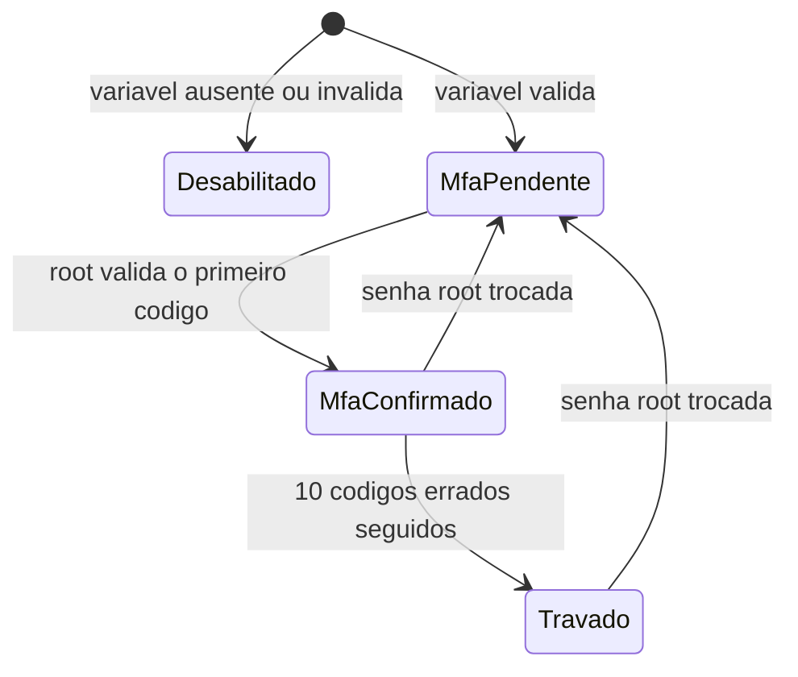
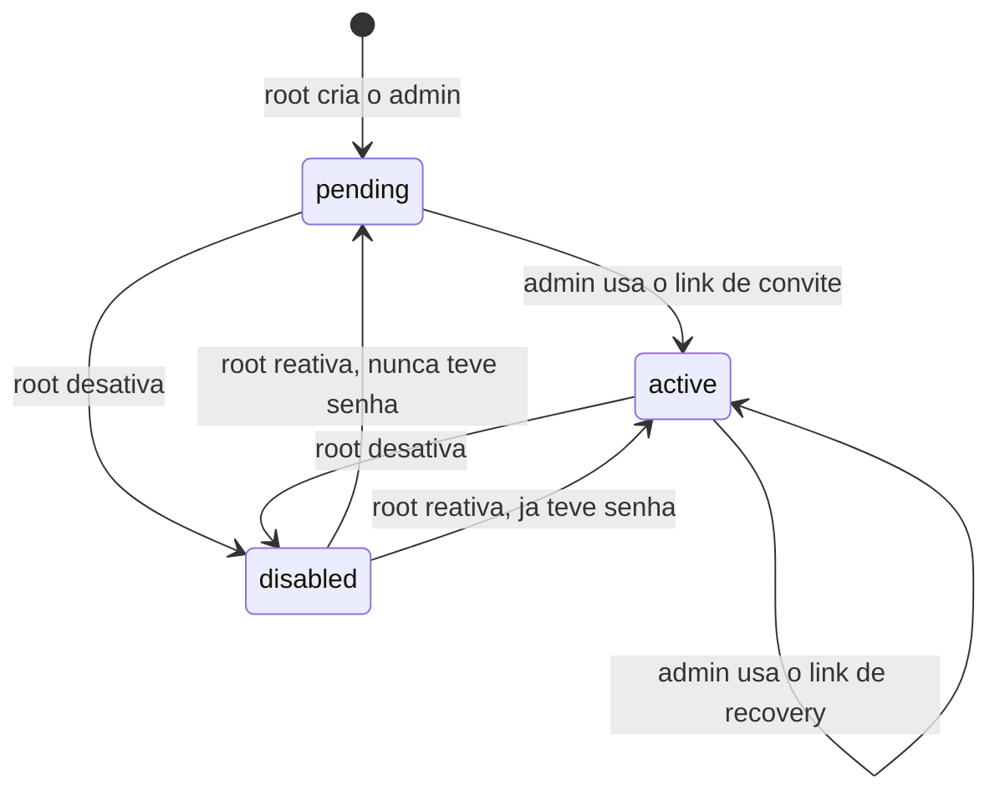

# Standard de Setup de Backoffice — Moljud

**Versão:** 2.0.0

Especificação das páginas, rotas e regras que todo app da Moljud deve seguir para o acesso
de **setup** e para a gestão dos seus **admins**. Este repositório contém somente a
especificação; nenhum código é implementado aqui.

As palavras **DEVE**, **NÃO DEVE**, **DEVERIA** e **PODE** indicam, nesta ordem: obrigação,
proibição, recomendação forte e opção.

## Sumário

1. [Visão geral e escopo](#1-visão-geral-e-escopo)
2. [Glossário](#2-glossário)
3. [Configuração](#3-configuração)
4. [Estado do setup](#4-estado-do-setup)
5. [Ciclo de vida do admin](#5-ciclo-de-vida-do-admin)
6. [Páginas](#6-páginas)
7. [API JSON](#7-api-json)
8. [Erros](#8-erros)
9. [Log de auditoria](#9-log-de-auditoria)
10. [Obrigações do app fora do setup](#10-obrigações-do-app-fora-do-setup)
11. [Requisitos de segurança](#11-requisitos-de-segurança)
12. [Fluxos de ponta a ponta](#12-fluxos-de-ponta-a-ponta)
13. [Riscos conhecidos](#13-riscos-conhecidos)
14. [Checklist de conformidade](#14-checklist-de-conformidade)

---

## 1. Visão geral e escopo

Cada app da Moljud implementa este standard por conta própria, com seu próprio banco de
dados. Não existe serviço central de autenticação.

O modelo tem dois níveis:

- O **root** entra em `/setup` com uma senha root mais um código MFA. O ambiente guarda
  apenas o hash SHA-256 dessa senha, nunca a senha em si. O root não é um usuário do sistema: ele só existe para gerenciar admins.
- O **admin** é um usuário de permissão alta dentro do app, criado pelo root. É o admin quem
  cria sub-usuários e administra o dia a dia do app.

Um admin nunca cria, remove ou promove outro admin. Isso só acontece em `/setup`.

### O que o standard cobre

- A página `/setup` e a API que ela usa.
- O MFA do root.
- Criar, editar, desativar e reativar admins.
- Links de convite e de recovery de admins, e as páginas onde o admin define a senha.
- O log de auditoria do setup.

### O que fica fora

- A tela de login, o logout e o mecanismo de sessão (JWT em cookie, definido por cada app).
- Sub-usuários, papéis e permissões.
- MFA de admins e de sub-usuários.
- Envio de email. O standard não envia nada: os links são entregues pelo root por fora.

## 2. Glossário

| Termo | Significado |
| --- | --- |
| **Root** | Quem possui a senha root e o MFA do setup. Não tem registro de usuário. |
| **Senha root** | Senha aleatória que o root digita em `/setup`. Só o root a conhece; o ambiente guarda apenas o hash. |
| **Setup** | A página `/setup` e a API `/api/setup/*`, de uso exclusivo do root. |
| **Admin** | Usuário de permissão alta do app, criado pelo root. |
| **Link de convite** | Link de uso único onde um admin recém-criado define sua primeira senha. |
| **Link de recovery** | Link de uso único onde um admin existente define uma nova senha. |
| **Segredo MFA** | Chave TOTP do root, exibida em texto e como QR code na configuração. |

## 3. Configuração

| Variável | Obrigatória | Regra |
| --- | --- | --- |
| `SETUP_ROOT_PASSWORD_SHA256` | Não | Hash SHA-256 da senha root: exatamente 64 caracteres hexadecimais. |

O ambiente **NÃO DEVE** conter a senha root, só o hash dela. Assim, quem consegue ler as
variáveis de ambiente (painel da cloud, pipeline de deploy, dump de configuração, backup)
não descobre a senha e não consegue entrar no setup.

### 3.1 Gerar a senha e o hash

- A senha root **DEVE** ter no mínimo 32 caracteres, gerados aleatoriamente. O standard não
  limita tentativas de senha; a proteção contra força bruta vem só do tamanho e da
  aleatoriedade. Uma senha de 32 caracteres escolhida por uma pessoa não atende ao standard.
- A senha **DEVERIA** ser gerada na máquina do root, fora da cloud, e guardada em um cofre de
  senhas. Só o hash vai para o ambiente.
- O hash é o SHA-256 dos bytes UTF-8 da senha, exatamente como será digitada, **sem quebra de
  linha no final**, escrito em hexadecimal.

Exemplo de geração:

```bash
SENHA="$(openssl rand -base64 32)"
echo "Senha root (guarde no cofre de senhas): $SENHA"
printf '%s' "$SENHA" | sha256sum | cut -d' ' -f1
```

No macOS, troque `sha256sum` por `shasum -a 256`.

> **Atenção:** `echo "$SENHA" | sha256sum` calcula o hash da senha **com** uma quebra de linha
> no final. O hash fica diferente e a senha correta passa a ser recusada com
> `401 INVALID_CREDENTIALS`. Use sempre `printf '%s'`.

### 3.2 Como o app usa a variável

- Se a variável estiver ausente, vazia ou não for exatamente 64 caracteres hexadecimais, o
  setup fica **desabilitado**: o app sobe normalmente, a página `/setup` mostra a tela de
  indisponível e toda rota `/api/setup/*` responde `503 SETUP_DISABLED`. Isso também pega o
  erro de colocar a senha em texto na variável, no lugar do hash.
- O app **DEVE** aceitar o hexadecimal em maiúsculas ou minúsculas e tratá-lo em minúsculas.
- Para verificar a senha recebida em `X-Setup-Password`, o app calcula o SHA-256 dela e
  compara, em tempo constante, com o hash da variável.
- O app **DEVE** recusar com `401 INVALID_CREDENTIALS` qualquer senha recebida com menos de 32
  caracteres, mesmo que o hash confira. Como o app não enxerga mais a senha na variável, este
  é o único ponto em que o tamanho mínimo é imposto por ele.
- Remover a variável é a forma oficial de desligar o setup em um ambiente.
- Desabilitar o setup não afeta admins existentes nem links já gerados: as rotas
  `/api/admin-links/*` continuam funcionando.

**Por que SHA-256 simples e não Argon2id ou bcrypt.** Hashes lentos existem para proteger
senhas fracas, escolhidas por pessoas. A senha root é aleatória e tem no mínimo 32
caracteres, então inverter o SHA-256 dela é inviável. Um hash lento, aqui, só deixaria cada
requisição de setup mais cara, e o standard não limita tentativas de senha: qualquer pessoa
na internet poderia usar isso para sobrecarregar o app.

### 3.3 Migração da versão 1.x

Na versão 1.x a variável se chamava `SETUP_ROOT_PASSWORD` e continha a senha em texto. Para
migrar:

1. Calcule o hash da senha atual com o comando da seção 3.1 e defina
   `SETUP_ROOT_PASSWORD_SHA256`.
2. Remova `SETUP_ROOT_PASSWORD` do ambiente.
3. Se o hash guardado pelo app na versão 1.x (seção 4) não for o SHA-256 em hexadecimal da
   senha, o app vai enxergar a migração como troca de senha root e descartar o MFA
   (seção 4.1). Nesse caso, o root **DEVERIA** estar pronto para configurar o MFA de novo
   logo após o deploy.

## 4. Estado do setup

O app **DEVE** persistir, fora da memória do processo:

- o hash da senha root em uso (o valor da variável, em minúsculas);
- o segredo MFA e se ele já foi confirmado;
- o contador de códigos MFA errados consecutivos;
- se o setup está travado;
- o último passo de tempo TOTP aceito.



### 4.1 Troca da senha root

Quando o hash da variável não corresponde ao hash guardado, o app **DEVE**, antes de atender
qualquer requisição de setup:

1. descartar o segredo MFA e marcar o MFA como não confirmado;
2. zerar o contador de erros e remover a trava;
3. guardar o novo hash;
4. registrar o evento `root_password_changed` na auditoria.

Admins, links pendentes e o log de auditoria **NÃO DEVEM** ser alterados pela troca.

Trocar a senha root (e, portanto, o hash na variável) é o único jeito de refazer o MFA e o único jeito de destravar o setup.

### 4.2 MFA do root

- Padrão TOTP (RFC 6238): SHA-1, 6 dígitos, período de 30 segundos, segredo de 160 bits em
  Base32.
- O app **DEVE** aceitar o código do passo atual e dos passos imediatamente anterior e
  seguinte, para tolerar diferença de relógio.
- **Cada código vale uma única vez.** O app guarda o último passo aceito e rejeita qualquer
  código de passo igual ou anterior com `409 MFA_CODE_ALREADY_USED`. Consequência prática: o
  root espera um código novo (até 30 segundos) entre uma ação e a seguinte.
- **Não existe código de recovery separado.** O recovery do MFA é o próprio segredo: quem o
  guardou consegue cadastrá-lo de novo em qualquer autenticador e obter os mesmos códigos.
- O segredo só é exibido enquanto o MFA não foi confirmado. Depois disso, nenhuma rota o
  devolve.

### 4.3 Trava por erros de MFA

- O contador soma **1** a cada código MFA errado enviado **junto com a senha correta**.
- Um acerto zera o contador.
- Código repetido (`MFA_CODE_ALREADY_USED`) e erros durante a configuração inicial do MFA não
  contam.
- Ao chegar a **10**, o setup fica **travado**: toda rota `/api/setup/*` com a senha correta
  responde `423 SETUP_LOCKED`, até a senha root ser trocada (seção 4.1).
- Não há bloqueio por tempo, por IP ou por número de senhas erradas.

## 5. Ciclo de vida do admin

| Status | Significado |
| --- | --- |
| `pending` | Criado pelo root, ainda não definiu a primeira senha. |
| `active` | Pode autenticar no app (desde que tenha senha, ver `has_password`). |
| `disabled` | Desativado pelo root. Não autentica. O registro é mantido. |



Regras:

- **Nunca há exclusão.** Desativar é a única forma de remover um admin.
- `username` e `email` são únicos entre todos os admins, inclusive os `disabled`, sem
  diferenciar maiúsculas de minúsculas.
- `username`: de 3 a 32 caracteres, apenas `a-z`, `0-9`, `.`, `_` e `-`.
- `email`: formato de email válido. O standard **não** verifica se o endereço existe ou
  pertence ao admin.
- **Desativar** revoga o link pendente e invalida todas as sessões do admin na hora. A senha
  guardada é mantida.
- **Reativar** devolve o admin ao status anterior. As sessões antigas continuam inválidas e
  nenhum link é recriado. Se a desativação foi por suspeita de invasão, o root **DEVERIA**
  gerar um link de recovery logo após reativar.

### 5.1 Links de convite e de recovery

- O tipo depende do status: admin `pending` recebe **convite**; admin `active` recebe
  **recovery**. Admin `disabled` não recebe link.
- O token **DEVE** ter no mínimo 32 bytes de um gerador criptograficamente seguro, codificado
  em base64url. O app guarda apenas o hash do token.
- Validade de **24 horas** a partir da geração.
- **Uso único**: ao definir a senha, o link é consumido.
- Cada admin tem no máximo um link pendente. Gerar um novo invalida o anterior.
- A URL completa só aparece na resposta da rota que gerou o link. Não há como consultá-la
  depois.
- **Gerar um link de recovery invalida imediatamente a senha atual e todas as sessões do
  admin.** Até usar o link, ele continua `active` com `has_password: false` e não consegue
  entrar.
- Revogar um link de recovery **não** restaura a senha antiga. O root precisa gerar outro.

## 6. Páginas

Todas as páginas deste standard **DEVEM** ser servidas com `Cache-Control: no-store`,
`Referrer-Policy: no-referrer` e `X-Robots-Tag: noindex`.

### 6.1 `GET /setup`

Página única que alterna entre as telas abaixo. Ela **NÃO DEVE** guardar a senha root nem
códigos MFA em cookie, `localStorage`, `sessionStorage` ou qualquer outro armazenamento, e
**DEVE** pedir senha e código novamente a cada ação. Não existe sessão de setup.

| Tela | Quando aparece | Conteúdo |
| --- | --- | --- |
| **Indisponível** | API responde `SETUP_DISABLED`. | Aviso de que o setup está desligado neste ambiente. |
| **Senha** | Estado inicial. | Campo de senha root. Ao enviar, chama `GET /api/setup/status`. |
| **Configurar MFA** | `mfa_configured` é `false`. | QR code, segredo em texto com botão de copiar, aviso para guardar o segredo, campo do código de 6 dígitos. |
| **Travado** | API responde `SETUP_LOCKED`. | Aviso de que é preciso gerar uma nova senha root e trocar `SETUP_ROOT_PASSWORD_SHA256` no ambiente. |
| **Código MFA** | `mfa_configured` é `true`. | Campo do código. Ao enviar, carrega o painel. |
| **Painel** | Senha e código aceitos. | Lista de admins, ações e log de auditoria. |

Regras da tela **Configurar MFA**:

- Aparece imediatamente após a senha correta, sem passar por nenhuma outra tela.
- **DEVE** avisar que o segredo é o único meio de recuperar o MFA e que não será mostrado
  outra vez.
- Recarregar a página antes de confirmar mostra o mesmo QR code e o mesmo segredo.
- Só depois de um código válido o MFA passa a valer.

Conteúdo do **Painel**:

- Lista de todos os admins, inclusive `disabled`, com `username`, `email`, status, se tem
  senha e, se houver, tipo e validade do link pendente.
- Formulário de **criar admin**: `username` e `email`.
- Por admin: **editar** nome/email, **desativar** ou **reativar**, **gerar link**, **revogar
  link**.
- Ao gerar um link, a URL é exibida uma única vez, com botão de copiar e aviso de que não
  poderá ser vista de novo.
- **Log de auditoria** paginado.
- Toda ação abre um pedido de senha root e de um código MFA novo.

### 6.2 `GET /admin-invite/{token}` e `GET /admin-recovery/{token}`

Páginas públicas, sem credencial root. As duas têm o mesmo comportamento; muda apenas o texto.

1. A página chama `GET /api/admin-links/{token}`.
2. Se a resposta for `LINK_INVALID`, ou se o `type` devolvido não corresponder ao caminho da
   página, mostra a tela de **link inválido ou expirado**, orientando a pedir um novo link.
3. Caso contrário, mostra `username` e `email` **somente leitura** e os campos **senha** e
   **confirmar senha**.
4. Ao enviar, chama `POST /api/admin-links/{token}`.
5. Em caso de sucesso, redireciona para a página de login do app. O admin **não** sai
   autenticado.

A confirmação de senha é validada apenas na página; a API recebe um único campo.

## 7. API JSON

### 7.1 Convenções

- Corpos de requisição e de resposta em `application/json; charset=utf-8`.
- Datas em ISO 8601, UTC (`2026-11-23T15:28:00Z`).
- Identificadores (`id`) são strings opacas.
- Toda resposta **DEVE** ter `Cache-Control: no-store`.
- Credenciais do root vão **somente** nestes headers, nunca na URL nem no corpo:

| Header | Conteúdo |
| --- | --- |
| `X-Setup-Password` | Senha root. |
| `X-Setup-MFA-Code` | Código TOTP de 6 dígitos. |

Na tabela de rotas, **S** significa que a rota exige só a senha e **S+M** que exige senha e
código MFA.

| Método | Rota | Credencial | Função |
| --- | --- | --- | --- |
| `GET` | `/api/setup/status` | S | Estado do setup. |
| `POST` | `/api/setup/mfa/enroll` | S | Obter segredo e QR code. |
| `POST` | `/api/setup/mfa/confirm` | S+M | Confirmar o MFA. |
| `GET` | `/api/setup/admins` | S+M | Listar admins. |
| `POST` | `/api/setup/admins` | S+M | Criar admin e link de convite. |
| `PATCH` | `/api/setup/admins/{id}` | S+M | Editar nome/email. |
| `POST` | `/api/setup/admins/{id}/deactivate` | S+M | Desativar. |
| `POST` | `/api/setup/admins/{id}/reactivate` | S+M | Reativar. |
| `POST` | `/api/setup/admins/{id}/link` | S+M | Gerar link de convite ou recovery. |
| `DELETE` | `/api/setup/admins/{id}/link` | S+M | Revogar link pendente. |
| `GET` | `/api/setup/audit-log` | S+M | Consultar auditoria. |
| `GET` | `/api/admin-links/{token}` | Nenhuma | Consultar um link. |
| `POST` | `/api/admin-links/{token}` | Nenhuma | Definir a senha e consumir o link. |

### 7.2 Ordem de verificação das rotas `/api/setup/*`

O app **DEVE** verificar nesta ordem e responder com o primeiro erro encontrado:

| # | Condição | Resposta |
| --- | --- | --- |
| 1 | Setup desabilitado. | `503 SETUP_DISABLED` |
| 2 | Senha ausente, com menos de 32 caracteres ou cujo SHA-256 não confere com a variável. | `401 INVALID_CREDENTIALS` |
| 3 | Setup travado. | `423 SETUP_LOCKED` |
| 4 | Rota S+M (exceto `mfa/confirm`) e MFA ainda não confirmado. | `409 MFA_NOT_CONFIGURED` |
| 5 | Rota S+M e header do código ausente. | `401 MFA_REQUIRED` |
| 6 | Corpo ou parâmetros em formato inválido. | `422 VALIDATION_ERROR` |
| 7 | Código de passo já aceito. | `409 MFA_CODE_ALREADY_USED` |
| 8 | Código incorreto. | `401 MFA_INVALID_CODE` (soma 1 ao contador; no 10º, `423 SETUP_LOCKED`) |
| 9 | Regras da própria rota. | Erros específicos. |

Pontos importantes:

- Sem a senha correta, a resposta é sempre `401 INVALID_CREDENTIALS`, mesmo com o setup
  travado ou sem MFA. Nada sobre o estado do setup é revelado a quem não tem a senha.
- A validação de formato (item 6) vem antes do código MFA para que um erro de digitação no
  formulário não gaste um código.
- Um código só é marcado como usado quando é aceito (passa pelo item 8).
- Erros do item 9 acontecem depois de o código ser consumido.

### 7.3 Objeto `Admin`

```json
{
  "id": "adm_01JD8Z3K",
  "username": "maria.silva",
  "email": "maria@exemplo.com",
  "status": "pending",
  "has_password": false,
  "created_at": "2026-11-23T15:28:00Z",
  "updated_at": "2026-11-23T15:28:00Z",
  "disabled_at": null,
  "link": {
    "type": "invite",
    "expires_at": "2026-11-24T15:28:00Z"
  }
}
```

- `status`: `pending`, `active` ou `disabled`.
- `link`: `null` quando não há link pendente e válido. `type` é `invite` ou `recovery`.
- `link.url` só existe nas respostas de `POST /api/setup/admins` e
  `POST /api/setup/admins/{id}/link`.
- A senha e seu hash nunca aparecem em nenhuma resposta.

### 7.4 `GET /api/setup/status`

Informa se o MFA já foi confirmado. É a primeira chamada da página `/setup`.

Resposta `200`:

```json
{ "mfa_configured": false }
```

### 7.5 `POST /api/setup/mfa/enroll`

Devolve o segredo MFA pendente. Na primeira chamada o segredo é gerado; chamadas seguintes,
enquanto o MFA não for confirmado, devolvem **o mesmo** segredo. Sem corpo.

Resposta `200`:

```json
{
  "secret": "JBSWY3DPEHPK3PXPJBSWY3DPEHPK3PXP",
  "otpauth_uri": "otpauth://totp/NomeDoApp:root?secret=JBSWY3DPEHPK3PXPJBSWY3DPEHPK3PXP&issuer=NomeDoApp&algorithm=SHA1&digits=6&period=30",
  "qr_code": "data:image/png;base64,iVBORw0KGgo..."
}
```

- `issuer` é o nome do app; a conta é sempre `root`.
- `qr_code` é a imagem do `otpauth_uri`, gerada pelo próprio app. O segredo **NÃO DEVE** ser
  enviado a nenhum serviço externo de geração de QR code.

Erros: `409 MFA_ALREADY_CONFIGURED` se o MFA já foi confirmado.

### 7.6 `POST /api/setup/mfa/confirm`

Confirma o MFA com o primeiro código gerado pelo autenticador. Sem corpo; o código vai no
header `X-Setup-MFA-Code`.

Resposta `204`, sem corpo. A partir daqui o segredo não é mais exibido.

Erros:

- `409 MFA_NOT_CONFIGURED` se `enroll` ainda não foi chamado.
- `409 MFA_ALREADY_CONFIGURED` se o MFA já foi confirmado.
- `401 MFA_INVALID_CODE` para código errado. **Não** soma ao contador da trava.

### 7.7 `GET /api/setup/admins`

Lista todos os admins, inclusive `disabled`, ordenados por `created_at`. Sem paginação.

Resposta `200`:

```json
{ "admins": [ { "id": "adm_01JD8Z3K", "username": "maria.silva", "...": "..." } ] }
```

### 7.8 `POST /api/setup/admins`

Cria um admin `pending` e já gera seu link de convite.

Corpo:

```json
{ "username": "maria.silva", "email": "maria@exemplo.com" }
```

Resposta `201`:

```json
{
  "admin": {
    "id": "adm_01JD8Z3K",
    "username": "maria.silva",
    "email": "maria@exemplo.com",
    "status": "pending",
    "has_password": false,
    "created_at": "2026-11-23T15:28:00Z",
    "updated_at": "2026-11-23T15:28:00Z",
    "disabled_at": null,
    "link": {
      "type": "invite",
      "expires_at": "2026-11-24T15:28:00Z",
      "url": "https://app.exemplo.com/admin-invite/3q2-7wAAAAECAwQFBgcICQoLDA0ODxAREhMUFRYXGBk"
    }
  }
}
```

Erros: `422 VALIDATION_ERROR`; `409 ADMIN_CONFLICT` se `username` ou `email` já existem.

### 7.9 `PATCH /api/setup/admins/{id}`

Altera `username`, `email` ou ambos. Permitido em qualquer status. Não afeta senha, sessões
nem links.

Corpo (ao menos um campo):

```json
{ "email": "maria.silva@exemplo.com" }
```

Resposta `200`: `{ "admin": { ... } }`.

Erros: `404 ADMIN_NOT_FOUND`; `422 VALIDATION_ERROR`; `409 ADMIN_CONFLICT`.

### 7.10 `POST /api/setup/admins/{id}/deactivate`

Muda o status para `disabled`, revoga o link pendente e invalida todas as sessões do admin
imediatamente. Sem corpo.

Resposta `200`: `{ "admin": { ... } }`.

Erros: `404 ADMIN_NOT_FOUND`; `409 ADMIN_INVALID_STATE` se já está `disabled`.

### 7.11 `POST /api/setup/admins/{id}/reactivate`

Devolve o admin ao status que tinha antes de ser desativado. Sem corpo.

Resposta `200`: `{ "admin": { ... } }`.

Erros: `404 ADMIN_NOT_FOUND`; `409 ADMIN_INVALID_STATE` se não está `disabled`.

### 7.12 `POST /api/setup/admins/{id}/link`

Gera um link novo e invalida o anterior, se houver. Sem corpo.

- Admin `pending`: link de **convite**.
- Admin `active`: link de **recovery**. A senha atual e todas as sessões são invalidadas na
  hora (`has_password` passa a `false`).

Resposta `201`: `{ "admin": { ... } }`, com `link.url` preenchido.

Erros: `404 ADMIN_NOT_FOUND`; `409 ADMIN_INVALID_STATE` se o admin está `disabled`.

### 7.13 `DELETE /api/setup/admins/{id}/link`

Revoga o link pendente. Não restaura senha invalidada por um recovery.

Resposta `200`: `{ "admin": { ... } }`, com `link: null`.

Erros: `404 ADMIN_NOT_FOUND`; `409 ADMIN_INVALID_STATE` se não há link pendente.

### 7.14 `GET /api/setup/audit-log`

Parâmetros de query:

| Parâmetro | Padrão | Regra |
| --- | --- | --- |
| `limit` | `50` | De 1 a 200. |
| `cursor` | — | Valor de `next_cursor` da página anterior. |

Resposta `200`, do evento mais recente para o mais antigo:

```json
{
  "items": [
    {
      "id": "evt_01JD8Z9P",
      "occurred_at": "2026-11-23T15:30:12Z",
      "event": "admin_created",
      "admin_id": "adm_01JD8Z3K",
      "ip": "203.0.113.7",
      "user_agent": "Mozilla/5.0 ...",
      "details": { "username": "maria.silva", "email": "maria@exemplo.com" }
    }
  ],
  "next_cursor": null
}
```

### 7.15 `GET /api/admin-links/{token}`

Pública. Devolve os dados necessários para montar a página do link.

Resposta `200`:

```json
{
  "type": "invite",
  "username": "maria.silva",
  "email": "maria@exemplo.com",
  "expires_at": "2026-11-24T15:28:00Z"
}
```

Erros: `404 LINK_INVALID` para token inexistente, expirado, já usado, revogado ou de admin
`disabled`. Todos os casos respondem de forma idêntica.

### 7.16 `POST /api/admin-links/{token}`

Pública. Define a senha do admin e consome o link.

Corpo:

```json
{ "password": "uma senha longa e pessoal" }
```

Regra da senha: de 12 a 128 caracteres.

Efeitos, de forma atômica:

1. grava o hash da senha (seção 11);
2. muda o status para `active`;
3. consome o link;
4. invalida todas as sessões existentes do admin;
5. registra `link_used` na auditoria.

Resposta `204`, sem corpo e **sem** cookie de sessão.

Erros: `404 LINK_INVALID`; `422 VALIDATION_ERROR`.

## 8. Erros

Toda resposta de erro tem este formato:

```json
{
  "error": {
    "code": "VALIDATION_ERROR",
    "message": "Dados inválidos.",
    "fields": { "username": "Use de 3 a 32 caracteres: a-z, 0-9, ponto, _ e -." }
  }
}
```

- `code` é estável e é o que clientes devem tratar.
- `message` é texto para pessoas e pode variar entre apps.
- `fields` só aparece em `VALIDATION_ERROR`.

| Código | HTTP | Quando |
| --- | --- | --- |
| `SETUP_DISABLED` | 503 | `SETUP_ROOT_PASSWORD_SHA256` ausente ou fora do formato de 64 caracteres hexadecimais. |
| `INVALID_CREDENTIALS` | 401 | Senha root ausente ou incorreta. |
| `SETUP_LOCKED` | 423 | 10 códigos MFA errados seguidos; exige troca da senha root. |
| `MFA_NOT_CONFIGURED` | 409 | A rota exige MFA confirmado e ele ainda não foi. |
| `MFA_ALREADY_CONFIGURED` | 409 | Tentativa de configurar um MFA já confirmado. |
| `MFA_REQUIRED` | 401 | Header `X-Setup-MFA-Code` ausente. |
| `MFA_INVALID_CODE` | 401 | Código MFA incorreto. |
| `MFA_CODE_ALREADY_USED` | 409 | Código de um passo de tempo já aceito. Aguardar o próximo. |
| `VALIDATION_ERROR` | 422 | Corpo ou parâmetros inválidos. |
| `ADMIN_NOT_FOUND` | 404 | Não existe admin com o `id` informado. |
| `ADMIN_CONFLICT` | 409 | `username` ou `email` já usados por outro admin. |
| `ADMIN_INVALID_STATE` | 409 | A ação não se aplica ao status atual do admin. |
| `LINK_INVALID` | 404 | Token inexistente, expirado, usado, revogado ou de admin desativado. |

## 9. Log de auditoria

O app **DEVE** registrar os eventos abaixo. O log é somente de acréscimo: nenhuma rota edita
ou apaga registros, e ele sobrevive à troca da senha root.

| Evento | Quando | `admin_id` |
| --- | --- | --- |
| `root_password_changed` | App detecta senha root diferente da guardada. | — |
| `mfa_configured` | MFA confirmado. | — |
| `mfa_failed` | Código MFA errado com senha correta. | — |
| `setup_locked` | Contador chegou a 10. | — |
| `admins_listed` | Listagem de admins. | — |
| `admin_created` | Admin criado. | Sim |
| `admin_updated` | Nome ou email alterado (`details` traz valores antigos e novos). | Sim |
| `admin_deactivated` | Admin desativado. | Sim |
| `admin_reactivated` | Admin reativado. | Sim |
| `link_generated` | Link gerado (`details.type`). | Sim |
| `link_revoked` | Link revogado pelo root. | Sim |
| `link_used` | Admin definiu a senha pelo link (`details.type`). | Sim |

Campos de cada registro: `id`, `occurred_at`, `event`, `admin_id` (ou `null`), `ip`,
`user_agent` e `details`.

O log **NÃO DEVE** conter senha root, códigos MFA, segredo MFA, tokens de link, URLs de link
nem senhas de admin.

Tentativas com senha root errada não entram neste log, porque qualquer pessoa na internet
conseguiria enchê-lo. O app **PODE** registrá-las nos seus logs de infraestrutura.

## 10. Obrigações do app fora do setup

Mesmo com login e sessão fora do escopo, o app **DEVE** garantir:

1. **Revogação imediata.** Em toda requisição autenticada de um admin, o app confere que ele
   está `active` e que a sessão não foi invalidada. Um JWT ainda dentro da validade não basta.
   Uma forma de fazer: guardar no admin um instante `sessions_valid_after` e rejeitar tokens
   emitidos antes dele.
2. **Sem gestão de admins por dentro do app.** Nenhuma tela ou rota fora de `/api/setup/*`
   cria, desativa, reativa ou edita admins, nem promove um sub-usuário a admin.
3. **Login só para `active` com senha.** Admins `pending`, `disabled` ou com
   `has_password: false` não autenticam.
4. **Sem atalho para a senha.** Qualquer fluxo de "esqueci minha senha" que o app ofereça a
   admins não pode contornar o link de recovery gerado pelo root.

## 11. Requisitos de segurança

- Todas as páginas e rotas deste standard **DEVEM** ser servidas apenas por HTTPS.
- O hash da senha root e os códigos MFA **DEVEM** ser comparados em tempo constante.
- A senha root em texto **NÃO DEVE** ser guardada em variável de ambiente, banco, arquivo de
  configuração ou cofre de segredos da cloud. O app só conhece o hash.
- Senha root, códigos MFA, segredo MFA, tokens e senhas de admin **NÃO DEVEM** aparecer em
  logs, URLs de `/api/setup/*`, mensagens de erro ou ferramentas de monitoramento.
- Os headers `X-Setup-Password` e `X-Setup-MFA-Code` **DEVEM** ser removidos de qualquer log
  de requisição, inclusive em proxies e balanceadores sob controle da Moljud.
- O segredo MFA **DEVERIA** ser guardado cifrado no banco.
- Senhas de admin **DEVEM** ser guardadas com Argon2id, scrypt ou bcrypt.
- Tokens de link são guardados apenas como hash (SHA-256 é suficiente, dado o tamanho).
- As rotas `/api/setup/*` **NÃO DEVEM** aceitar requisições de outras origens (sem CORS
  liberado).
- A página `/setup` **NÃO DEVE** carregar scripts de terceiros.

## 12. Fluxos de ponta a ponta

### 12.1 Primeiro setup

1. O root gera a senha e o hash (seção 3.1), guarda a senha no cofre, a equipe define
   `SETUP_ROOT_PASSWORD_SHA256` com o hash e sobe o app.
2. O root abre `/setup` e informa a senha → `GET /api/setup/status` devolve
   `mfa_configured: false`.
3. A página chama `POST /api/setup/mfa/enroll` e mostra o QR code e o segredo.
4. O root guarda o segredo em local seguro e lê o QR code no autenticador.
5. O root digita o código → `POST /api/setup/mfa/confirm` → `204`.
6. O root informa a senha e um novo código → `GET /api/setup/admins` → painel.

### 12.2 Criar um admin

1. No painel, o root preenche `username` e `email`, informa senha e código →
   `POST /api/setup/admins`.
2. A página mostra a URL de convite uma única vez. O root copia e envia ao admin por um canal
   seguro.
3. O admin abre `/admin-invite/{token}`, confere nome e email, define a senha →
   `POST /api/admin-links/{token}`.
4. O admin é levado ao login do app e entra com a nova senha.

### 12.3 Recuperar um admin

1. O root clica em **gerar link** no admin → `POST /api/setup/admins/{id}/link`.
2. A senha antiga e as sessões do admin deixam de valer imediatamente.
3. O root entrega a URL de recovery. O admin abre `/admin-recovery/{token}` e define a nova
   senha.

### 12.4 Root perdeu o autenticador

- **Tem o segredo guardado:** cadastra o mesmo segredo em outro autenticador. Nada muda no
  app.
- **Não tem o segredo:** gera uma nova senha root, troca `SETUP_ROOT_PASSWORD_SHA256` no
  ambiente e reinicia o app. O MFA é descartado e o fluxo 12.1 recomeça do passo 2. Admins
  não são afetados.

### 12.5 Setup travado

1. Após 10 códigos errados seguidos, toda rota de setup responde `423 SETUP_LOCKED`.
2. Como a trava só é alcançada por quem tem a senha correta, ela indica senha vazada ou
   autenticador errado. Nos dois casos a saída é a mesma: gerar uma nova senha root e trocar
   `SETUP_ROOT_PASSWORD_SHA256`.
3. Após a troca, o setup volta ao estado de MFA pendente (fluxo 12.1).

## 13. Riscos conhecidos

Estas são consequências aceitas do desenho. Quem implementa e quem opera precisa conhecê-las.

- **A senha root é a única barreira contra força bruta.** Não há limite de tentativas de
  senha. Se ela não for realmente aleatória, o setup fica exposto.
- **Quem altera variáveis de ambiente controla o setup.** Guardar só o hash impede que quem
  **lê** o ambiente descubra a senha, mas quem **escreve** nele pode trocar o hash pelo de uma
  senha própria, o que também reseta o MFA. O acesso de escrita ao ambiente de deploy continua
  equivalendo a acesso root.
- **O hash não protege a senha em trânsito.** A senha root chega ao app em texto, dentro do
  HTTPS. Quem termina o TLS (balanceador, proxy, CDN) ou lê a memória do processo consegue
  vê-la. O hash protege contra vazamento de configuração, não contra a infraestrutura que
  atende as requisições.
- **O tamanho e a aleatoriedade da senha dependem de quem a gera.** O app só enxerga o hash
  na variável; ele recusa senhas recebidas com menos de 32 caracteres, mas não tem como saber
  se a senha foi realmente sorteada.
- **Janela antes do MFA.** Entre subir o app e confirmar o MFA, a senha sozinha basta para
  configurar o autenticador. O MFA **DEVERIA** ser configurado logo após o deploy e logo após
  qualquer troca de senha.
- **O segredo MFA é o recovery.** Quem copiar o segredo durante a configuração gera códigos
  válidos para sempre, até a senha root ser trocada.
- **Links são entregues por fora.** O email do admin não é verificado e o link vale 24 horas.
  Quem interceptar o link dentro desse prazo assume a conta.
- **Um código por ação.** O root espera até 30 segundos entre ações. É o preço de impedir a
  reutilização de códigos.
- **Admin em recovery fica sem acesso.** Entre gerar o link de recovery e o admin usá-lo, ele
  não consegue entrar no app.

## 14. Checklist de conformidade

**Configuração e estado**

- [ ] Setup desabilitado (`503 SETUP_DISABLED`) com a variável ausente ou fora do formato de 64 caracteres hexadecimais.
- [ ] O ambiente guarda só o hash SHA-256 da senha root, nunca a senha.
- [ ] Senha recebida com menos de 32 caracteres é recusada com `401 INVALID_CREDENTIALS`.
- [ ] Trocar a senha root descarta o MFA, zera o contador e remove a trava.
- [ ] Trocar a senha root não altera admins, links nem auditoria.
- [ ] O estado do setup sobrevive a reinícios do app.

**MFA**

- [ ] Sem MFA confirmado, a tela de configuração aparece logo após a senha.
- [ ] QR code gerado no próprio app; segredo exibido em texto.
- [ ] O segredo deixa de ser exibido depois da confirmação.
- [ ] Cada código é aceito uma única vez.
- [ ] 10 códigos errados seguidos travam o setup até a troca da senha root.
- [ ] Não existe bloqueio por tempo nem por IP.

**API de setup**

- [ ] Toda rota `/api/setup/*` exige a senha; as de gestão exigem também o código MFA.
- [ ] Não existe sessão de setup; a página não guarda senha nem código.
- [ ] Sem a senha correta, a resposta é sempre `401 INVALID_CREDENTIALS`.
- [ ] A ordem de verificação da seção 7.2 é respeitada.
- [ ] Erros seguem o formato e os códigos da seção 8.

**Admins e links**

- [ ] Admin é criado com `username` e `email`, sem verificação de email.
- [ ] `username` e `email` são únicos, inclusive entre desativados.
- [ ] Não existe exclusão de admin, apenas desativação e reativação.
- [ ] Desativar revoga o link e derruba as sessões na hora.
- [ ] Links: token de 32 bytes, guardado como hash, uso único, 24 horas, um por admin.
- [ ] A URL do link só é exibida no momento da geração.
- [ ] Gerar recovery invalida senha e sessões do admin imediatamente.
- [ ] A página do link mostra nome e email somente leitura e só pede a senha.
- [ ] Depois de definir a senha, o admin vai para o login, sem sessão criada.

**App e segurança**

- [ ] Toda requisição autenticada confere se o admin está `active` e a sessão é válida.
- [ ] Nenhuma rota fora do setup cria, edita, desativa ou promove admins.
- [ ] Todos os eventos da seção 9 são registrados, sem segredos.
- [ ] HTTPS obrigatório, comparação em tempo constante e `Cache-Control: no-store`.
- [ ] Credenciais não aparecem em logs nem em URLs.
