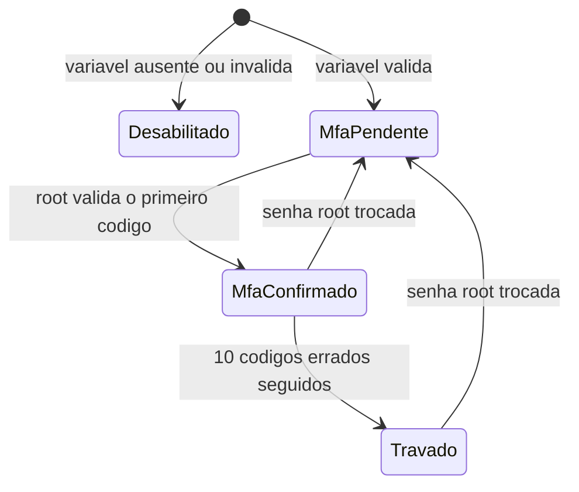
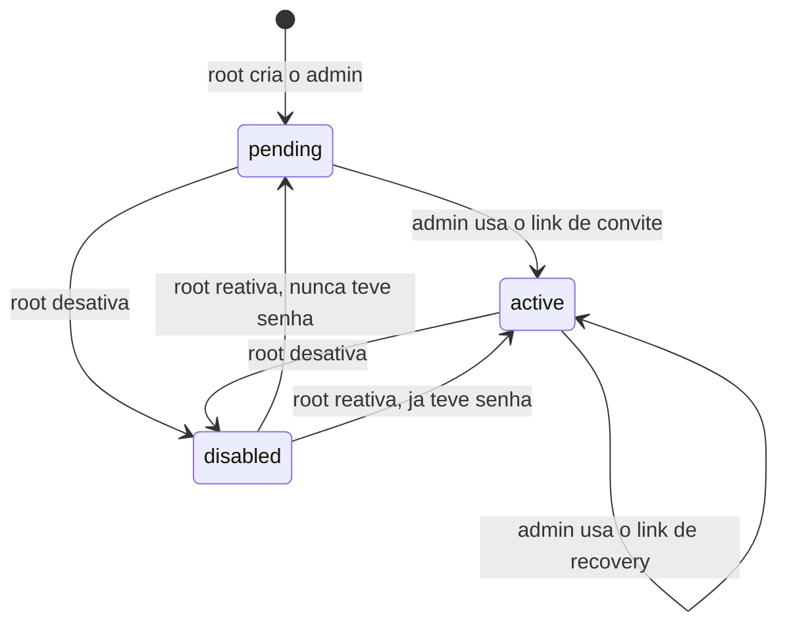

# Standard de Setup de Backoffice — Moljud

**Versão:** 1.1.0

Especificação das páginas, rotas e regras que todo app da Moljud deve seguir para o acesso
de **setup** e para a gestão dos seus **admins**. Este repositório contém somente a
especificação; nenhum código é implementado aqui.

As palavras **DEVE**, **NÃO DEVE**, **DEVERIA** e **PODE** indicam, nesta ordem: obrigação,
proibição, recomendação forte e opção.

## Sumário

1. [Visão geral e escopo](#1-visão-geral-e-escopo)
2. [Glossário](#2-glossário)
3. [Configuração](#3-configuração)
4. [Estado do setup](#4-estado-do-setup)
5. [Ciclo de vida do admin](#5-ciclo-de-vida-do-admin)
6. [Páginas](#6-páginas)
7. [API JSON](#7-api-json)
8. [Erros](#8-erros)
9. [Log de auditoria](#9-log-de-auditoria)
10. [Obrigações do app fora do setup](#10-obrigações-do-app-fora-do-setup)
11. [Requisitos de segurança](#11-requisitos-de-segurança)
12. [Fluxos de ponta a ponta](#12-fluxos-de-ponta-a-ponta)
13. [Riscos conhecidos](#13-riscos-conhecidos)
14. [Checklist de conformidade](#14-checklist-de-conformidade)

---

## 1. Visão geral e escopo

Cada app da Moljud implementa este standard por conta própria, com seu próprio banco de
dados. Não existe serviço central de autenticação.

O modelo tem dois níveis:

- O **root** entra em `/setup` com uma senha root mais um código MFA. O ambiente guarda
  apenas o hash SHA-256 dessa senha, nunca a senha em si. O root não é um usuário do sistema: ele só existe para gerenciar admins.
- O **admin** é um usuário de permissão alta dentro do app, criado pelo root. É o admin quem
  cria sub-usuários e administra o dia a dia do app.

Um admin nunca cria, remove ou promove outro admin. Isso só acontece em `/setup`.

### O que o standard cobre

- A página `/setup` e a API que ela usa.
- O MFA do root.
- Criar, editar, desativar e reativar admins.
- Links de convite e de recovery de admins, e as páginas onde o admin define a senha.
- O log de auditoria do setup.

### O que fica fora

- A tela de login, o logout e o mecanismo de sessão (JWT em cookie, definido por cada app).
- Sub-usuários, papéis e permissões.
- MFA de admins e de sub-usuários.
- Envio de email. O standard não envia nada: os links são entregues pelo root por fora.

## 2. Glossário

| Termo | Significado |
| --- | --- |
| **Root** | Quem possui a senha root e o MFA do setup. Não tem registro de usuário. |
| **Senha root** | Senha aleatória que o root digita em `/setup`. Só o root a conhece; o ambiente guarda apenas o hash. |
| **Setup** | A página `/setup` e a API `/api/setup/*`, de uso exclusivo do root. |
| **Admin** | Usuário de permissão alta do app, criado pelo root. |
| **Link de convite** | Link de uso único onde um admin recém-criado define sua primeira senha. |
| **Link de recovery** | Link de uso único onde um admin existente define uma nova senha. |
| **Segredo MFA** | Chave TOTP do root, exibida em texto e como QR code na configuração. |

## 3. Configuração

| Variável | Obrigatória | Regra |
| --- | --- | --- |
| `SETUP_ROOT_PASSWORD_SHA256` | Não | Hash SHA-256 da senha root: exatamente 64 caracteres hexadecimais. |

O ambiente **NÃO DEVE** conter a senha root, só o hash dela. Assim, quem consegue ler as
variáveis de ambiente (painel da cloud, pipeline de deploy, dump de configuração, backup)
não descobre a senha e não consegue entrar no setup.

### 3.1 Gerar a senha e o hash

- A senha root **DEVE** ter no mínimo 32 caracteres, gerados aleatoriamente. O standard não
  limita tentativas de senha; a proteção contra força bruta vem só do tamanho e da
  aleatoriedade. Uma senha de 32 caracteres escolhida por uma pessoa não atende ao standard.
- A senha **DEVE** usar somente letras `A-Z` e `a-z`, dígitos `0-9` e os símbolos
  `+ / = - _ . ~`. Sem espaços, acentos ou outros símbolos: a senha viaja em um header HTTP,
  que não transporta esses caracteres de forma confiável. O `openssl rand -base64` e os
  geradores alfanuméricos já respeitam essa regra.
- Cada app e cada ambiente (produção, staging, preview) **DEVE** ter a sua própria senha
  root. A senha chega em texto ao app que a recebe; se fosse a mesma em todos, um ambiente
  comprometido entregaria o acesso aos demais.
- A senha **DEVERIA** ser gerada na máquina do root, fora da cloud, e guardada em um cofre de
  senhas. Só o hash vai para o ambiente.
- O hash é o SHA-256 dos bytes UTF-8 da senha, exatamente como será digitada, **sem quebra de
  linha no final**, escrito em hexadecimal.

Exemplo de geração:

```bash
SENHA="$(openssl rand -base64 32)"
echo "Senha root (guarde no cofre de senhas): $SENHA"
printf '%s' "$SENHA" | sha256sum | cut -d' ' -f1
```

No macOS, troque `sha256sum` por `shasum -a 256`.

> **Atenção:** `echo "$SENHA" | sha256sum` calcula o hash da senha **com** uma quebra de linha
> no final. O hash fica diferente e a senha correta passa a ser recusada com
> `401 INVALID_CREDENTIALS`. Use sempre `printf '%s'`.

#### Pelo navegador, sem terminal

Quem não quiser usar o terminal pode gerar a senha e o hash no console do próprio navegador.
Nada é enviado a nenhum site: o sorteio e o cálculo acontecem na máquina do root.

1. Abra uma página HTTPS de confiança (por exemplo, a página inicial do próprio app). Em aba
   em branco o comando não funciona, porque o navegador só libera a função de hash em páginas
   HTTPS.
2. Abra o console (F12, aba **Console**), cole o comando abaixo e aperte Enter. Se o navegador
   pedir uma confirmação antes de aceitar texto colado, siga a instrução que ele mostra.

```js
(async () => {
  const bytes = crypto.getRandomValues(new Uint8Array(32));
  const senha = btoa(String.fromCharCode(...bytes));
  const digest = await crypto.subtle.digest('SHA-256', new TextEncoder().encode(senha));
  const hash = Array.from(new Uint8Array(digest), b => b.toString(16).padStart(2, '0')).join('');
  console.log('Senha root (guarde no cofre de senhas):', senha);
  console.log('SETUP_ROOT_PASSWORD_SHA256:', hash);
})();
```

3. Guarde a senha no cofre de senhas, copie o hash para `SETUP_ROOT_PASSWORD_SHA256` e feche a
   aba.

Cuidados:

- O root **NÃO DEVE** colar a senha root em sites de terceiros que calculam hash ou "testam a
  força" da senha. Quem controla a página pode registrá-la.
- Cole no console apenas o comando acima, copiado deste documento. Colar no console comandos
  de origem desconhecida é uma forma comum de golpe.

### 3.2 Como o app usa a variável

- Se a variável estiver ausente, vazia ou não for exatamente 64 caracteres hexadecimais, o
  setup fica **desabilitado**: o app sobe normalmente, a página `/setup` mostra a tela de
  indisponível e toda rota `/api/setup/*` responde `503 SETUP_DISABLED`. Isso também pega o
  erro de colocar a senha em texto na variável, no lugar do hash.
- O app **DEVE** aceitar o hexadecimal em maiúsculas ou minúsculas e tratá-lo em minúsculas.
- Para verificar a senha recebida no header `Authorization` (seção 7.1), o app calcula o
  SHA-256 dela e compara, em tempo constante, com o hash da variável.
- O app **DEVE** recusar com `401 INVALID_CREDENTIALS` qualquer senha recebida com menos de 32
  caracteres ou com caractere fora do alfabeto da seção 3.1, mesmo que o hash confira. Como o
  app não enxerga mais a senha na variável, este é o único ponto em que essas duas regras são
  impostas por ele.
- Remover a variável é a forma oficial de desligar o setup em um ambiente.
- Desabilitar o setup não afeta admins existentes nem links já gerados: as rotas
  `/api/admin-links/*` continuam funcionando.

**Por que SHA-256 simples e não Argon2id ou bcrypt.** Hashes lentos existem para proteger
senhas fracas, escolhidas por pessoas. A senha root é aleatória e tem no mínimo 32
caracteres, então inverter o SHA-256 dela é inviável. Um hash lento, aqui, só deixaria cada
requisição de setup mais cara, e o standard não limita tentativas de senha: qualquer pessoa
na internet poderia usar isso para sobrecarregar o app.

## 4. Estado do setup

O app **DEVE** persistir, fora da memória do processo:

- o hash da senha root em uso (o valor da variável, em minúsculas);
- o segredo MFA, se ele já foi confirmado e quantas vezes foi exibido;
- o contador de códigos MFA errados consecutivos;
- se o setup está travado;
- o último passo de tempo TOTP aceito.

As mudanças nesse estado **DEVEM** ser atômicas no armazenamento persistente, para que
requisições simultâneas não contornem as regras:

- **Contador e trava.** O app reserva a tentativa antes de comparar o código: soma 1 ao
  contador em uma operação atômica, que só acontece se ele estiver abaixo de 10, e só então
  compara. Um acerto zera o contador. Assim, por mais requisições que cheguem ao mesmo tempo,
  nunca são avaliados mais de 10 códigos errados seguidos.
- **Código de uso único.** Aceitar um código e gravar o último passo aceito é uma única
  operação condicional: só grava se o passo for maior que o guardado. De duas requisições
  simultâneas com o mesmo código, apenas uma é aceita.

O armazenamento **DEVE** ter consistência forte e permitir escrita condicional ou transação.
Armazenamentos de consistência eventual (um key-value replicado, por exemplo) não atendem a
este requisito.



### 4.1 Troca da senha root

Quando o hash da variável não corresponde ao hash guardado, o app **DEVE**, antes de atender
qualquer requisição de setup:

1. descartar o segredo MFA e marcar o MFA como não confirmado;
2. zerar o contador de erros e remover a trava;
3. guardar o novo hash;
4. registrar o evento `root_password_changed` na auditoria.

Admins, links pendentes e o log de auditoria **NÃO DEVEM** ser alterados pela troca.

Trocar a senha root (e, portanto, o hash na variável) é o único jeito de refazer o MFA e o único jeito de destravar o setup.

### 4.2 MFA do root

- Padrão TOTP (RFC 6238): SHA-1, 6 dígitos, período de 30 segundos, segredo de 160 bits em
  Base32.
- O app **DEVE** aceitar o código do passo atual e dos passos imediatamente anterior e
  seguinte, para tolerar diferença de relógio.
- **Cada código vale uma única vez.** O app guarda o último passo aceito e rejeita qualquer
  código de passo igual ou anterior com `409 MFA_CODE_ALREADY_USED`. Consequência prática: o
  root espera um código novo (até 30 segundos) entre uma ação e a seguinte.
- **Não existe código de recovery separado.** O recovery do MFA é o próprio segredo: quem o
  guardou consegue cadastrá-lo de novo em qualquer autenticador e obter os mesmos códigos.
- O segredo só é exibido enquanto o MFA não foi confirmado. Depois disso, nenhuma rota o
  devolve.
- Toda exibição do segredo é auditada (`mfa_secret_viewed`) e contada. A tela de configuração
  mostra quantas vezes o segredo já foi exibido, para o root perceber se outra pessoa o viu
  antes dele (seção 7.5).

### 4.3 Trava por erros de MFA

- O contador soma **1** a cada código MFA errado enviado **junto com a senha correta**.
- Um acerto zera o contador.
- Código repetido (`MFA_CODE_ALREADY_USED`) e erros durante a configuração inicial do MFA não
  contam.
- Ao chegar a **10**, o setup fica **travado**: toda rota `/api/setup/*` com a senha correta
  responde `423 SETUP_LOCKED`, até a senha root ser trocada (seção 4.1).
- Não há bloqueio por tempo, por IP ou por número de senhas erradas.

Um código errado enviado com a senha correta significa que alguém além do root pode ter a
senha, e cada acerto do root zera o contador. Para que isso não passe despercebido:

- A cada `mfa_failed` e a cada `setup_locked`, o app **DEVE** escrever uma linha de nível
  erro nos seus logs de infraestrutura (sem segredos) e **DEVERIA** disparar o alerta que a
  equipe usa para incidentes.
- O painel **DEVE** avisar o root quando houve códigos errados desde o último acesso dele
  (seções 6.1 e 7.7).

## 5. Ciclo de vida do admin

| Status | Significado |
| --- | --- |
| `pending` | Criado pelo root, ainda não definiu a primeira senha. |
| `active` | Pode autenticar no app (desde que tenha senha, ver `has_password`). |
| `disabled` | Desativado pelo root. Não autentica. O registro é mantido. |



Regras:

- **Nunca há exclusão.** Desativar é a única forma de remover um admin.
- `username` e `email` são únicos entre todos os admins, inclusive os `disabled`, sem
  diferenciar maiúsculas de minúsculas.
- `username`: de 3 a 32 caracteres, apenas `a-z`, `0-9`, `.`, `_` e `-`.
- `email`: formato de email válido. O standard **não** verifica se o endereço existe ou
  pertence ao admin.
- **Desativar** revoga o link pendente e invalida todas as sessões do admin na hora. A senha
  guardada é mantida.
- **Reativar** devolve o admin ao status anterior. As sessões antigas continuam inválidas e
  nenhum link é recriado. Se a desativação foi por suspeita de invasão, o root **DEVERIA**
  gerar um link de recovery logo após reativar.

### 5.1 Links de convite e de recovery

- O tipo depende do status: admin `pending` recebe **convite**; admin `active` recebe
  **recovery**. Admin `disabled` não recebe link.
- O token **DEVE** ter no mínimo 32 bytes de um gerador criptograficamente seguro, codificado
  em base64url. O app guarda apenas o hash do token.
- Validade de **24 horas** a partir da geração.
- **Uso único**: ao definir a senha, o link é consumido.
- O token vai no **fragmento** da URL (`https://app.exemplo.com/admin-invite#{token}`), nunca
  no caminho nem na query. O navegador não envia o fragmento ao servidor, então o token não
  entra em logs de acesso, proxies, CDN nem no header `Referer`. Nas chamadas à API, o token
  vai no corpo da requisição.
- Cada admin tem no máximo um link pendente. Gerar um novo invalida o anterior.
- A URL completa só aparece na resposta da rota que gerou o link. Não há como consultá-la
  depois.
- **Gerar um link de recovery invalida imediatamente a senha atual e todas as sessões do
  admin.** Até usar o link, ele continua `active` com `has_password: false` e não consegue
  entrar.
- Revogar um link de recovery **não** restaura a senha antiga. O root precisa gerar outro.

## 6. Páginas

Todas as páginas deste standard **DEVEM** ser servidas com estes headers:

| Header | Valor |
| --- | --- |
| `Cache-Control` | `no-store` |
| `Referrer-Policy` | `no-referrer` |
| `X-Robots-Tag` | `noindex` |
| `X-Frame-Options` | `DENY` |
| `Strict-Transport-Security` | `max-age=31536000` ou maior. |
| `Content-Security-Policy` | No mínimo `default-src 'self'; img-src 'self' data:; frame-ancestors 'none'; base-uri 'none'; form-action 'self'`. |

- A política **NÃO DEVE** liberar `'unsafe-inline'` nem `'unsafe-eval'` para scripts. Scripts
  inline do próprio app **PODEM** ser liberados por nonce ou hash.
- `img-src data:` existe para o QR code, que chega como `data:` URI.
- `frame-ancestors 'none'` e `X-Frame-Options` impedem que a página seja aberta dentro de
  outra, para capturar cliques ou a senha.
- Todo valor vindo da API **DEVE** ser exibido como texto, nunca interpretado como HTML. Isso
  vale em especial para o `user_agent` do log de auditoria, que é escrito por quem faz a
  requisição.

### 6.1 `GET /setup`

Página única que alterna entre as telas abaixo. Não existe sessão de setup: toda requisição
leva a senha root, e toda ação pede um código MFA novo.

- A página **NÃO DEVE** guardar a senha root nem códigos MFA em cookie, `localStorage`,
  `sessionStorage` ou qualquer outro armazenamento do navegador.
- A página **PODE** manter a senha root em memória (uma variável do script) enquanto a aba
  estiver aberta, para o root não precisar colá-la a cada ação. Nesse caso ela **DEVE**
  descartá-la ao recarregar ou fechar a aba e após 5 minutos sem nenhuma ação.
- O código MFA nunca é reaproveitado: a página pede um novo a cada ação.

| Tela | Quando aparece | Conteúdo |
| --- | --- | --- |
| **Indisponível** | API responde `SETUP_DISABLED`. | Aviso de que o setup está desligado neste ambiente. |
| **Senha** | Estado inicial. | Campo de senha root. Ao enviar, chama `GET /api/setup/status`. |
| **Configurar MFA** | `mfa_configured` é `false`. | QR code, segredo em texto com botão de copiar, aviso para guardar o segredo, quantas vezes o segredo já foi exibido, campo do código de 6 dígitos. |
| **Travado** | API responde `SETUP_LOCKED`. | Aviso de que é preciso gerar uma nova senha root e trocar `SETUP_ROOT_PASSWORD_SHA256` no ambiente. |
| **Código MFA** | `mfa_configured` é `true`. | Campo do código. Ao enviar, carrega o painel. |
| **Painel** | Senha e código aceitos. | Lista de admins e ações. O log de auditoria é aberto à parte, a pedido do root. |

Regras da tela **Configurar MFA**:

- Aparece imediatamente após a senha correta, sem passar por nenhuma outra tela.
- **DEVE** avisar que o segredo é o único meio de recuperar o MFA e que não será mostrado
  outra vez.
- Recarregar a página antes de confirmar mostra o mesmo QR code e o mesmo segredo.
- **DEVE** mostrar o `view_count` devolvido por `mfa/enroll`. Se ele for maior que 1, a tela
  avisa que o segredo já foi exibido antes e que, se não foi o próprio root (recarregando a
  página, por exemplo), outra pessoa pode tê-lo copiado: nesse caso o root troca a senha root
  em vez de confirmar.
- Só depois de um código válido o MFA passa a valer.

Conteúdo do **Painel**:

- Lista de todos os admins, inclusive `disabled`, com `username`, `email`, status, se tem
  senha e, se houver, tipo e validade do link pendente.
- **Aviso de códigos errados.** Se `mfa_failed_since_last_listing` (seção 7.7) for maior que
  zero, o painel **DEVE** mostrar em destaque quantos códigos MFA errados foram enviados com
  a senha correta desde o último acesso, e orientar: se não foram do próprio root, a senha
  root vazou e precisa ser trocada.
- Formulário de **criar admin**: `username` e `email`.
- Por admin: **editar** nome/email, **desativar** ou **reativar**, **gerar link**, **revogar
  link**.
- Ao gerar um link, a URL é exibida uma única vez, com botão de copiar e aviso de que não
  poderá ser vista de novo.
- **Log de auditoria** paginado, carregado somente quando o root pede. Abrir o log e avançar
  cada página são ações: cada uma pede um código MFA novo.
- Toda ação abre um pedido de um código MFA novo (e da senha root, se a página não a tiver
  em memória). Depois de uma ação, a página atualiza a lista com o objeto `admin` devolvido
  na resposta, sem listar tudo de novo.

### 6.2 `GET /admin-invite` e `GET /admin-recovery`

Páginas públicas, sem credencial root. As duas têm o mesmo comportamento; muda apenas o texto.
O token chega no fragmento da URL (`/admin-invite#{token}`), que o navegador não envia ao
servidor.

1. A página lê o token do fragmento, guarda-o apenas em memória e o remove da barra de
   endereço (`history.replaceState`).
2. A página chama `POST /api/admin-links/lookup` com o token no corpo.
3. Se não houver fragmento, se a resposta for `LINK_INVALID` ou se o `type` devolvido não
   corresponder ao caminho da página, mostra a tela de **link inválido ou expirado**,
   orientando a pedir um novo link.
4. Caso contrário, mostra `username` e `email` **somente leitura** e os campos **senha** e
   **confirmar senha**.
5. Ao enviar, chama `POST /api/admin-links/use` com o token e a senha no corpo.
6. Em caso de sucesso, redireciona para a página de login do app. O admin **não** sai
   autenticado.

Abrir a página não consome o link: só o envio da senha consome. Assim, pré-visualizadores de
link de aplicativos de mensagem e de email não invalidam o convite.

A confirmação de senha é validada apenas na página; a API recebe um único campo.

## 7. API JSON

### 7.1 Convenções

- Corpos de requisição e de resposta em `application/json; charset=utf-8`.
- Datas em ISO 8601, UTC (`2026-11-23T15:28:00Z`).
- Identificadores (`id`) são strings opacas.
- Toda resposta **DEVE** ter `Cache-Control: no-store`.
- Credenciais do root vão **somente** nestes headers, nunca na URL nem no corpo:

| Header | Conteúdo |
| --- | --- |
| `Authorization` | `Setup <senha root>`: a palavra `Setup`, um espaço e a senha. |
| `X-Setup-MFA-Code` | Código TOTP de 6 dígitos. |

A senha vai em `Authorization`, e não em um header próprio, porque ferramentas de log,
monitoramento, CDN e WAF mascaram `Authorization` por padrão; um header próprio só seria
mascarado onde alguém lembrasse de configurar. O código MFA pode ir em header próprio porque
vale uma única vez. O app **NÃO DEVE** responder com `WWW-Authenticate: Basic`, para o
navegador não abrir a janela nativa de usuário e senha.

Na tabela de rotas, **S** significa que a rota exige só a senha e **S+M** que exige senha e
código MFA.

| Método | Rota | Credencial | Função |
| --- | --- | --- | --- |
| `GET` | `/api/setup/status` | S | Estado do setup. |
| `POST` | `/api/setup/mfa/enroll` | S | Obter segredo e QR code. |
| `POST` | `/api/setup/mfa/confirm` | S+M | Confirmar o MFA. |
| `GET` | `/api/setup/admins` | S+M | Listar admins. |
| `POST` | `/api/setup/admins` | S+M | Criar admin e link de convite. |
| `PATCH` | `/api/setup/admins/{id}` | S+M | Editar nome/email. |
| `POST` | `/api/setup/admins/{id}/deactivate` | S+M | Desativar. |
| `POST` | `/api/setup/admins/{id}/reactivate` | S+M | Reativar. |
| `POST` | `/api/setup/admins/{id}/link` | S+M | Gerar link de convite ou recovery. |
| `DELETE` | `/api/setup/admins/{id}/link` | S+M | Revogar link pendente. |
| `GET` | `/api/setup/audit-log` | S+M | Consultar auditoria. |
| `POST` | `/api/admin-links/lookup` | Nenhuma | Consultar um link (token no corpo). |
| `POST` | `/api/admin-links/use` | Nenhuma | Definir a senha e consumir o link (token no corpo). |

### 7.2 Ordem de verificação das rotas `/api/setup/*`

O app **DEVE** verificar nesta ordem e responder com o primeiro erro encontrado:

| # | Condição | Resposta |
| --- | --- | --- |
| 1 | Setup desabilitado. | `503 SETUP_DISABLED` |
| 2 | Header `Authorization` ausente ou fora do formato `Setup <senha>`; senha com menos de 32 caracteres, com caractere fora do alfabeto da seção 3.1 ou cujo SHA-256 não confere com a variável. | `401 INVALID_CREDENTIALS` |
| 3 | Setup travado. | `423 SETUP_LOCKED` |
| 4 | Rota S+M (exceto `mfa/confirm`) e MFA ainda não confirmado; ou `mfa/confirm` sem segredo gerado por `mfa/enroll`. | `409 MFA_NOT_CONFIGURED` |
| 5 | `mfa/enroll` ou `mfa/confirm` e MFA já confirmado. | `409 MFA_ALREADY_CONFIGURED` |
| 6 | Rota S+M e header do código ausente. | `401 MFA_REQUIRED` |
| 7 | Código MFA que não tem exatamente 6 dígitos; corpo ou parâmetros em formato inválido. | `422 VALIDATION_ERROR` |
| 8 | Código válido para um passo da janela (seção 4.2) igual ou anterior ao último passo aceito. | `409 MFA_CODE_ALREADY_USED` |
| 9 | Código incorreto. | `401 MFA_INVALID_CODE` (soma 1 ao contador; no 10º, `423 SETUP_LOCKED`). Em `mfa/confirm` não soma. |
| 10 | Regras da própria rota. | Erros específicos. |

Pontos importantes:

- Sem a senha correta, a resposta é sempre `401 INVALID_CREDENTIALS`, mesmo com o setup
  travado ou sem MFA. Nada sobre o estado do setup é revelado a quem não tem a senha.
- Os itens 4 e 5 vêm antes de qualquer comparação de código. `mfa/enroll` e `mfa/confirm`
  **NÃO DEVEM** comparar um código com um MFA já confirmado: como erros em `mfa/confirm` não
  somam ao contador, a rota serviria para testar códigos sem limite.
- A validação de formato (item 7) vem antes da comparação do código para que um erro de
  digitação no formulário não gaste um código. Um código MFA fora do formato de 6 dígitos
  não pode estar certo, então não soma ao contador; o erro vem em `fields.mfa_code`.
- Um código só é marcado como usado quando é aceito (passa pelo item 9).
- Erros do item 10 acontecem depois de o código ser consumido.

### 7.3 Objeto `Admin`

```json
{
  "id": "adm_01JD8Z3K",
  "username": "maria.silva",
  "email": "maria@exemplo.com",
  "status": "pending",
  "has_password": false,
  "created_at": "2026-11-23T15:28:00Z",
  "updated_at": "2026-11-23T15:28:00Z",
  "disabled_at": null,
  "link": {
    "type": "invite",
    "expires_at": "2026-11-24T15:28:00Z"
  }
}
```

- `status`: `pending`, `active` ou `disabled`.
- `link`: `null` quando não há link pendente e válido. `type` é `invite` ou `recovery`.
- `link.url` só existe nas respostas de `POST /api/setup/admins` e
  `POST /api/setup/admins/{id}/link`.
- A senha e seu hash nunca aparecem em nenhuma resposta.

### 7.4 `GET /api/setup/status`

Informa se o MFA já foi confirmado. É a primeira chamada da página `/setup`.

Resposta `200`:

```json
{ "mfa_configured": false }
```

### 7.5 `POST /api/setup/mfa/enroll`

Devolve o segredo MFA pendente. Na primeira chamada o segredo é gerado; chamadas seguintes,
enquanto o MFA não for confirmado, devolvem **o mesmo** segredo. Sem corpo.

Cada chamada bem-sucedida soma 1 ao `view_count` do segredo e registra `mfa_secret_viewed`
na auditoria.

Resposta `200`:

```json
{
  "secret": "JBSWY3DPEHPK3PXPJBSWY3DPEHPK3PXP",
  "otpauth_uri": "otpauth://totp/NomeDoApp:root?secret=JBSWY3DPEHPK3PXPJBSWY3DPEHPK3PXP&issuer=NomeDoApp&algorithm=SHA1&digits=6&period=30",
  "qr_code": "data:image/png;base64,iVBORw0KGgo...",
  "view_count": 1
}
```

- `issuer` é o nome do app; a conta é sempre `root`.
- `qr_code` é a imagem do `otpauth_uri`, gerada pelo próprio app. O segredo **NÃO DEVE** ser
  enviado a nenhum serviço externo de geração de QR code.
- `view_count` é quantas vezes este segredo já foi devolvido, contando a chamada atual. Volta
  a zero quando o segredo é descartado (seção 4.1).

Erros: `409 MFA_ALREADY_CONFIGURED` se o MFA já foi confirmado.

### 7.6 `POST /api/setup/mfa/confirm`

Confirma o MFA com o primeiro código gerado pelo autenticador. Sem corpo; o código vai no
header `X-Setup-MFA-Code`.

Resposta `204`, sem corpo. A partir daqui o segredo não é mais exibido.

Erros:

- `409 MFA_NOT_CONFIGURED` se `enroll` ainda não foi chamado.
- `409 MFA_ALREADY_CONFIGURED` se o MFA já foi confirmado. Esta verificação acontece **antes**
  de o código ser comparado (seção 7.2, item 5): com o MFA confirmado, a rota nunca diz se um
  código está certo ou errado.
- `401 MFA_INVALID_CODE` para código errado, com o MFA ainda pendente. **Não** soma ao
  contador da trava: nessa fase, quem tem a senha já consegue ver o segredo.

### 7.7 `GET /api/setup/admins`

Lista todos os admins, inclusive `disabled`, ordenados por `created_at`. Sem paginação.

Resposta `200`:

```json
{
  "mfa_failed_since_last_listing": 0,
  "admins": [ { "id": "adm_01JD8Z3K", "username": "maria.silva", "...": "..." } ]
}
```

`mfa_failed_since_last_listing` é a quantidade de eventos `mfa_failed` registrados depois da
listagem anterior (evento `admins_listed`) ou, na primeira listagem, depois de `mfa_configured`.
Quem tem só a senha não consegue listar, então não consegue zerar esse número.

### 7.8 `POST /api/setup/admins`

Cria um admin `pending` e já gera seu link de convite.

Corpo:

```json
{ "username": "maria.silva", "email": "maria@exemplo.com" }
```

Resposta `201`:

```json
{
  "admin": {
    "id": "adm_01JD8Z3K",
    "username": "maria.silva",
    "email": "maria@exemplo.com",
    "status": "pending",
    "has_password": false,
    "created_at": "2026-11-23T15:28:00Z",
    "updated_at": "2026-11-23T15:28:00Z",
    "disabled_at": null,
    "link": {
      "type": "invite",
      "expires_at": "2026-11-24T15:28:00Z",
      "url": "https://app.exemplo.com/admin-invite#3q2-7wAAAAECAwQFBgcICQoLDA0ODxAREhMUFRYXGBk"
    }
  }
}
```

Erros: `422 VALIDATION_ERROR`; `409 ADMIN_CONFLICT` se `username` ou `email` já existem em
outro admin ou em qualquer outra conta que entra pelo mesmo login (seção 10, item 5).

### 7.9 `PATCH /api/setup/admins/{id}`

Altera `username`, `email` ou ambos. Permitido em qualquer status. Não afeta senha, sessões
nem links.

Corpo (ao menos um campo):

```json
{ "email": "maria.silva@exemplo.com" }
```

Resposta `200`: `{ "admin": { ... } }`.

Erros: `404 ADMIN_NOT_FOUND`; `422 VALIDATION_ERROR`; `409 ADMIN_CONFLICT`.

### 7.10 `POST /api/setup/admins/{id}/deactivate`

Muda o status para `disabled`, revoga o link pendente e invalida todas as sessões do admin
imediatamente. Sem corpo.

Resposta `200`: `{ "admin": { ... } }`.

Erros: `404 ADMIN_NOT_FOUND`; `409 ADMIN_INVALID_STATE` se já está `disabled`.

### 7.11 `POST /api/setup/admins/{id}/reactivate`

Devolve o admin ao status que tinha antes de ser desativado. Sem corpo.

Resposta `200`: `{ "admin": { ... } }`.

Erros: `404 ADMIN_NOT_FOUND`; `409 ADMIN_INVALID_STATE` se não está `disabled`.

### 7.12 `POST /api/setup/admins/{id}/link`

Gera um link novo e invalida o anterior, se houver. Sem corpo.

- Admin `pending`: link de **convite**.
- Admin `active`: link de **recovery**. A senha atual e todas as sessões são invalidadas na
  hora (`has_password` passa a `false`).

Resposta `201`: `{ "admin": { ... } }`, com `link.url` preenchido.

Erros: `404 ADMIN_NOT_FOUND`; `409 ADMIN_INVALID_STATE` se o admin está `disabled`.

### 7.13 `DELETE /api/setup/admins/{id}/link`

Revoga o link pendente. Não restaura senha invalidada por um recovery.

Resposta `200`: `{ "admin": { ... } }`, com `link: null`.

Erros: `404 ADMIN_NOT_FOUND`; `409 ADMIN_INVALID_STATE` se não há link pendente.

### 7.14 `GET /api/setup/audit-log`

Parâmetros de query:

| Parâmetro | Padrão | Regra |
| --- | --- | --- |
| `limit` | `50` | De 1 a 200. |
| `cursor` | — | Valor de `next_cursor` da página anterior. |

Resposta `200`, do evento mais recente para o mais antigo:

```json
{
  "items": [
    {
      "id": "evt_01JD8Z9P",
      "occurred_at": "2026-11-23T15:30:12Z",
      "event": "admin_created",
      "admin_id": "adm_01JD8Z3K",
      "ip": "203.0.113.7",
      "user_agent": "Mozilla/5.0 ...",
      "details": { "username": "maria.silva", "email": "maria@exemplo.com" }
    }
  ],
  "next_cursor": null
}
```

### 7.15 `POST /api/admin-links/lookup`

Pública. Devolve os dados necessários para montar a página do link. Não altera nada: o
método é `POST` apenas para o token ir no corpo, fora da URL.

Corpo:

```json
{ "token": "3q2-7wAAAAECAwQFBgcICQoLDA0ODxAREhMUFRYXGBk" }
```

Resposta `200`:

```json
{
  "type": "invite",
  "username": "maria.silva",
  "email": "maria@exemplo.com",
  "expires_at": "2026-11-24T15:28:00Z"
}
```

Erros: `404 LINK_INVALID` para token ausente, malformado, inexistente, expirado, já usado,
revogado ou de admin `disabled`. Todos os casos respondem de forma idêntica.

### 7.16 `POST /api/admin-links/use`

Pública. Define a senha do admin e consome o link.

Corpo:

```json
{
  "token": "3q2-7wAAAAECAwQFBgcICQoLDA0ODxAREhMUFRYXGBk",
  "password": "uma senha longa e pessoal"
}
```

Regras da senha:

- De 12 a 128 caracteres. Em apps que guardam a senha com bcrypt, o limite superior é de 72
  bytes em UTF-8 (seção 11).
- O app **DEVERIA** recusar senhas que constem em listas de senhas comuns ou vazadas.

O app verifica o token **antes** de validar a senha e só calcula o hash da senha para um
link válido. Assim, quem não tem um link não consegue fazer o app gastar processamento com
o hash lento.

Efeitos, de forma atômica:

1. grava o hash da senha (seção 11);
2. muda o status para `active`;
3. consome o link;
4. invalida todas as sessões existentes do admin;
5. registra `link_used` na auditoria.

Resposta `204`, sem corpo e **sem** cookie de sessão.

Erros: `404 LINK_INVALID`; `422 VALIDATION_ERROR`.

## 8. Erros

Toda resposta de erro tem este formato:

```json
{
  "error": {
    "code": "VALIDATION_ERROR",
    "message": "Dados inválidos.",
    "fields": { "username": "Use de 3 a 32 caracteres: a-z, 0-9, ponto, _ e -." }
  }
}
```

- `code` é estável e é o que clientes devem tratar.
- `message` é texto para pessoas e pode variar entre apps.
- `fields` só aparece em `VALIDATION_ERROR`.

| Código | HTTP | Quando |
| --- | --- | --- |
| `SETUP_DISABLED` | 503 | `SETUP_ROOT_PASSWORD_SHA256` ausente ou fora do formato de 64 caracteres hexadecimais. |
| `INVALID_CREDENTIALS` | 401 | Header `Authorization` ausente ou fora do formato; senha root curta, com caractere não permitido ou incorreta. |
| `SETUP_LOCKED` | 423 | 10 códigos MFA errados seguidos; exige troca da senha root. |
| `MFA_NOT_CONFIGURED` | 409 | A rota exige MFA confirmado e ele ainda não foi. |
| `MFA_ALREADY_CONFIGURED` | 409 | `mfa/enroll` ou `mfa/confirm` com o MFA já confirmado. Respondido sem comparar o código. |
| `MFA_REQUIRED` | 401 | Header `X-Setup-MFA-Code` ausente. |
| `MFA_INVALID_CODE` | 401 | Código MFA incorreto. |
| `MFA_CODE_ALREADY_USED` | 409 | Código de um passo de tempo já aceito. Aguardar o próximo. |
| `VALIDATION_ERROR` | 422 | Corpo ou parâmetros inválidos, inclusive código MFA que não tem 6 dígitos. |
| `ADMIN_NOT_FOUND` | 404 | Não existe admin com o `id` informado. |
| `ADMIN_CONFLICT` | 409 | `username` ou `email` já usados por outro admin ou por outra conta do mesmo login. |
| `ADMIN_INVALID_STATE` | 409 | A ação não se aplica ao status atual do admin. |
| `LINK_INVALID` | 404 | Token ausente, malformado, inexistente, expirado, usado, revogado ou de admin desativado. |

## 9. Log de auditoria

O app **DEVE** registrar os eventos abaixo. O log é somente de acréscimo: nenhuma rota edita
ou apaga registros, e ele sobrevive à troca da senha root.

| Evento | Quando | `admin_id` |
| --- | --- | --- |
| `root_password_changed` | App detecta senha root diferente da guardada. | — |
| `mfa_secret_viewed` | Segredo MFA devolvido por `mfa/enroll` (`details.view_count`). | — |
| `mfa_configured` | MFA confirmado. | — |
| `mfa_failed` | Código MFA errado com senha correta. | — |
| `setup_locked` | Contador chegou a 10. | — |
| `admins_listed` | Listagem de admins. | — |
| `admin_created` | Admin criado. | Sim |
| `admin_updated` | Nome ou email alterado (`details` traz valores antigos e novos). | Sim |
| `admin_deactivated` | Admin desativado. | Sim |
| `admin_reactivated` | Admin reativado. | Sim |
| `link_generated` | Link gerado (`details.type`). | Sim |
| `link_revoked` | Link revogado pelo root. | Sim |
| `link_used` | Admin definiu a senha pelo link (`details.type`). | Sim |

Campos de cada registro: `id`, `occurred_at`, `event`, `admin_id` (ou `null`), `ip`,
`user_agent` e `details`.

O log **NÃO DEVE** conter senha root, códigos MFA, segredo MFA, tokens de link, URLs de link
nem senhas de admin.

Tentativas com senha root errada não entram neste log, porque qualquer pessoa na internet
conseguiria enchê-lo. O app **PODE** registrá-las nos seus logs de infraestrutura.

**Valores vindos da requisição.** `ip` e `user_agent` são escritos por quem faz a requisição
e **DEVEM** ser tratados como texto não confiável: o `user_agent` é cortado em 512 caracteres
ao gravar e exibido sempre como texto, nunca como HTML (seção 6).

**Retenção.** O log guarda dados pessoais (email, IP, navegador). Cada app **DEVE** definir e
documentar por quanto tempo guarda os registros. Passado o prazo, os registros **PODEM** ser
apagados por uma rotina interna do app; continua não existindo rota que edite ou apague o
log.

## 10. Obrigações do app fora do setup

Mesmo com login e sessão fora do escopo, o app **DEVE** garantir:

1. **Revogação imediata.** Em toda requisição autenticada de um admin, o app confere que ele
   está `active` e que a sessão não foi invalidada. Um JWT ainda dentro da validade não basta.
   Uma forma de fazer: guardar no admin um instante `sessions_valid_after` e rejeitar tokens
   emitidos antes dele.
2. **Sem gestão de admins por dentro do app.** Nenhuma tela ou rota fora de `/api/setup/*`
   cria, desativa, reativa ou edita admins, nem promove um sub-usuário a admin.
3. **Login só para `active` com senha.** Admins `pending`, `disabled` ou com
   `has_password: false` não autenticam.
4. **Sem atalho para a senha.** Qualquer fluxo de "esqueci minha senha" que o app ofereça a
   admins não pode contornar o link de recovery gerado pelo root.
5. **Sem colisão de identificadores de login.** Se admins e outras contas (sub-usuários)
   entram pelo mesmo login, o `username` e o `email` de um admin **DEVEM** ser únicos também
   em relação a essas contas. Criar ou editar um admin com um identificador já usado responde
   `409 ADMIN_CONFLICT`, e o app não deixa outra conta passar a usar o `username` ou o `email`
   de um admin, inclusive `disabled`.
6. **Limite de tentativas no login.** O login de admins **DEVE** limitar tentativas de senha
   (por conta e por origem). O admin é a conta de maior poder no dia a dia e, neste standard,
   é protegido apenas por uma senha escolhida por uma pessoa.
7. **MFA de admins.** O formato fica fora do escopo, mas o app **DEVERIA** exigir um segundo
   fator dos admins.

## 11. Requisitos de segurança

- Todas as páginas e rotas deste standard **DEVEM** ser servidas apenas por HTTPS.
- O hash da senha root e os códigos MFA **DEVEM** ser comparados em tempo constante.
- A senha root em texto **NÃO DEVE** ser guardada em variável de ambiente, banco, arquivo de
  configuração ou cofre de segredos da cloud. O app só conhece o hash.
- Senha root, códigos MFA, segredo MFA, tokens e senhas de admin **NÃO DEVEM** aparecer em
  logs, em nenhuma URL enviada ao servidor (caminho ou query), em mensagens de erro ou em
  ferramentas de monitoramento. O token de link só existe no fragmento da URL e no corpo das
  chamadas a `/api/admin-links/*`.
- O header `Authorization` das rotas de setup e o header `X-Setup-MFA-Code` **DEVEM** ser
  removidos de qualquer log de requisição, inclusive em proxies e balanceadores sob controle
  da Moljud. O corpo das chamadas a `/api/admin-links/*` também **NÃO DEVE** ser registrado.
- O segredo MFA **DEVERIA** ser guardado cifrado no banco.
- Senhas de admin **DEVEM** ser guardadas com Argon2id, scrypt ou PBKDF2-HMAC-SHA256. O app
  **DEVERIA** usar Argon2id ou scrypt sempre que a plataforma os ofereça de forma nativa.
- O PBKDF2-HMAC-SHA256 existe para plataformas sem Argon2id nem scrypt nativos e com limite
  curto de processamento por requisição, como o plano gratuito do Cloudflare Workers. Quando
  usado, o app **DEVE** gerar um sal aleatório de no mínimo 16 bytes para cada senha, usar no
  mínimo 100.000 iterações e guardar o número de iterações junto do hash, para poder
  aumentá-lo depois sem invalidar as senhas existentes. O app que usa PBKDF2 **DEVE** cumprir
  o limite de tentativas de login da seção 10.
- O bcrypt ignora o que passa de 72 bytes; ele só **PODE** ser usado se o app recusar, com
  `422 VALIDATION_ERROR`, senhas com mais de 72 bytes em UTF-8.
- Tokens de link são guardados apenas como hash (SHA-256 é suficiente, dado o tamanho).
- As rotas `/api/setup/*` **NÃO DEVEM** aceitar requisições de outras origens (sem CORS
  liberado).
- As páginas deste standard **NÃO DEVEM** carregar scripts de terceiros e **DEVEM** enviar os
  headers da seção 6.
- As mudanças no contador de erros e no último passo aceito **DEVEM** ser atômicas (seção 4).

## 12. Fluxos de ponta a ponta

### 12.1 Primeiro setup

1. O root gera a senha e o hash (seção 3.1), guarda a senha no cofre, a equipe define
   `SETUP_ROOT_PASSWORD_SHA256` com o hash e sobe o app.
2. O root abre `/setup` e informa a senha → `GET /api/setup/status` devolve
   `mfa_configured: false`.
3. A página chama `POST /api/setup/mfa/enroll` e mostra o QR code e o segredo.
4. O root guarda o segredo em local seguro e lê o QR code no autenticador.
5. O root confere que a tela mostra o segredo como exibido uma única vez, digita o código →
   `POST /api/setup/mfa/confirm` → `204`.
6. O root informa um novo código → `GET /api/setup/admins` → painel.

### 12.2 Criar um admin

1. No painel, o root preenche `username` e `email`, informa um código novo →
   `POST /api/setup/admins`.
2. A página mostra a URL de convite uma única vez. O root copia e envia ao admin por um canal
   seguro.
3. O admin abre `/admin-invite#{token}`, confere nome e email, define a senha →
   `POST /api/admin-links/use`.
4. O admin é levado ao login do app e entra com a nova senha.

### 12.3 Recuperar um admin

1. O root clica em **gerar link** no admin → `POST /api/setup/admins/{id}/link`.
2. A senha antiga e as sessões do admin deixam de valer imediatamente.
3. O root entrega a URL de recovery. O admin abre `/admin-recovery#{token}` e define a nova
   senha.

### 12.4 Root perdeu o autenticador

- **Tem o segredo guardado:** cadastra o mesmo segredo em outro autenticador. Nada muda no
  app.
- **Não tem o segredo:** gera uma nova senha root, troca `SETUP_ROOT_PASSWORD_SHA256` no
  ambiente e reinicia o app. O MFA é descartado e o fluxo 12.1 recomeça do passo 2. Admins
  não são afetados.

### 12.5 Setup travado

1. Após 10 códigos errados seguidos, toda rota de setup responde `423 SETUP_LOCKED`.
2. Como a trava só é alcançada por quem tem a senha correta, ela indica senha vazada ou
   autenticador errado. Nos dois casos a saída é a mesma: gerar uma nova senha root e trocar
   `SETUP_ROOT_PASSWORD_SHA256`.
3. Após a troca, o setup volta ao estado de MFA pendente (fluxo 12.1).

### 12.6 Troca de quem é o root

Quando a pessoa que guarda a senha root e o segredo MFA deixa a função, ou quando mais alguém
passa a precisar do acesso:

1. A nova pessoa gera uma nova senha root (seção 3.1) e a equipe troca
   `SETUP_ROOT_PASSWORD_SHA256`.
2. O MFA é descartado e a nova pessoa refaz o fluxo 12.1 a partir do passo 2.
3. A senha e o segredo antigos deixam de valer. Admins não são afetados.

Passar a senha e o segredo adiante, sem trocá-los, não tira o acesso de quem saiu.

### 12.7 Códigos MFA errados que não foram do root

1. O painel avisa que houve códigos errados desde o último acesso, ou a equipe recebe o
   alerta de `mfa_failed`.
2. Se o root não reconhece as tentativas, alguém tem a senha root. O root gera uma nova senha
   e troca `SETUP_ROOT_PASSWORD_SHA256`, sem esperar a trava.
3. O root confere no log de auditoria se houve ação que ele não fez.

## 13. Riscos conhecidos

Estas são consequências aceitas do desenho. Quem implementa e quem opera precisa conhecê-las.

- **A senha root é a única barreira contra força bruta.** Não há limite de tentativas de
  senha. Se ela não for realmente aleatória, o setup fica exposto.
- **Quem altera variáveis de ambiente controla o setup.** Guardar só o hash impede que quem
  **lê** o ambiente descubra a senha, mas quem **escreve** nele pode trocar o hash pelo de uma
  senha própria, o que também reseta o MFA. O acesso de escrita ao ambiente de deploy continua
  equivalendo a acesso root.
- **Quem lê o ambiente costuma ler também a credencial do banco.** O hash protege a senha
  root, não o app: com acesso direto ao banco, dá para criar um admin ou ler o segredo MFA
  sem passar pelo setup. A credencial do banco precisa do mesmo cuidado que a senha root.
- **O hash não protege a senha em trânsito.** A senha root chega ao app em texto, dentro do
  HTTPS. Quem termina o TLS (balanceador, proxy, CDN) ou lê a memória do processo consegue
  vê-la. O hash protege contra vazamento de configuração, não contra a infraestrutura que
  atende as requisições.
- **O tamanho e a aleatoriedade da senha dependem de quem a gera.** O app só enxerga o hash
  na variável; ele recusa senhas recebidas com menos de 32 caracteres, mas não tem como saber
  se a senha foi realmente sorteada.
- **Janela antes do MFA.** Entre subir o app e confirmar o MFA, a senha sozinha basta para
  configurar o autenticador. O MFA **DEVERIA** ser configurado logo após o deploy e logo após
  qualquer troca de senha.
- **O segredo MFA é o recovery.** Quem copiar o segredo durante a configuração gera códigos
  válidos para sempre, até a senha root ser trocada. O contador de exibições e o evento
  `mfa_secret_viewed` mostram que isso aconteceu, mas não impedem.
- **Senha vazada pode ser testada aos poucos.** Cada acerto do root zera o contador, então
  quem tem a senha ganha novas tentativas de código a cada ação do root, sem travar o setup.
  A chance de acerto é pequena; a defesa é o aviso no painel e o alerta de `mfa_failed`, que
  só funcionam se alguém reagir trocando a senha (fluxo 12.7).
- **Links são entregues por fora.** O email do admin não é verificado e o link vale 24 horas.
  Quem interceptar o link dentro desse prazo assume a conta.
- **O admin é o elo mais fraco.** O root usa senha aleatória de 32 caracteres e TOTP; o admin,
  uma senha escolhida por ele. Sem limite de tentativas no login e sem segundo fator (seção
  10), o cuidado com o setup protege pouco.
- **PBKDF2 resiste menos que Argon2id e scrypt.** Ele não exige memória, então quem obtiver
  uma cópia do banco testa senhas em GPU muito mais rápido. Em apps que usam PBKDF2 (seção
  11), a proteção das senhas de admin depende mais do tamanho mínimo de 12 caracteres, da
  recusa de senhas comuns e do limite de tentativas no login. Mesmo com 100.000 iterações, o
  cálculo pode passar do limite de processamento de planos gratuitos; cada app **DEVERIA**
  medir o login no ambiente real antes de entrar em produção.
- **Um código por ação.** O root espera até 30 segundos entre ações, inclusive entre páginas
  do log de auditoria. É o preço de impedir a reutilização de códigos.
- **Senha root em memória na página.** Se a página mantém a senha em memória (seção 6.1), um
  script malicioso que rode nela consegue lê-la. Um script assim também capturaria a senha
  quando digitada; a defesa é a mesma nos dois casos: a política de conteúdo da seção 6 e
  nenhum script de terceiros.
- **Admin em recovery fica sem acesso.** Entre gerar o link de recovery e o admin usá-lo, ele
  não consegue entrar no app.
- **O root é uma credencial, não uma pessoa.** A auditoria registra IP e navegador, mas não
  distingue quem agiu se mais de uma pessoa conhece a senha e o segredo. Quando alguém deixa
  a função, é preciso trocar a senha (fluxo 12.6).
- **Restaurar um backup do banco desfaz revogações.** Admins desativados voltam ao status
  antigo, sessões invalidadas e links já usados ou revogados podem voltar a valer, e o
  contador e a trava voltam ao valor antigo. Depois de uma restauração, o root **DEVERIA**
  conferir o status de cada admin, gerar link de recovery para os ativos e revogar os links
  pendentes.
- **Não há exclusão de dados pessoais.** Admins nunca são apagados e o log guarda email, IP e
  navegador. O prazo de retenção do log é definido por cada app (seção 9); um pedido de
  eliminação de dados de um ex-admin precisa ser tratado fora deste standard.
- **Cada app reimplementa as partes sensíveis.** TOTP, contador atômico e comparação em tempo
  constante são fáceis de errar. Os apps **DEVERIAM** compartilhar uma mesma biblioteca e uma
  mesma bateria de testes baseada no checklist da seção 14, em vez de cada um escrever a sua.

## 14. Checklist de conformidade

**Configuração e estado**

- [ ] Setup desabilitado (`503 SETUP_DISABLED`) com a variável ausente ou fora do formato de 64 caracteres hexadecimais.
- [ ] O ambiente guarda só o hash SHA-256 da senha root, nunca a senha.
- [ ] Senha recebida com menos de 32 caracteres ou com caractere fora do alfabeto permitido é recusada com `401 INVALID_CREDENTIALS`.
- [ ] Cada app e cada ambiente tem a sua própria senha root.
- [ ] Trocar a senha root descarta o MFA, zera o contador e remove a trava.
- [ ] Trocar a senha root não altera admins, links nem auditoria.
- [ ] O estado do setup sobrevive a reinícios do app.
- [ ] O estado fica em armazenamento de consistência forte, com contador e último passo atualizados de forma atômica.

**MFA**

- [ ] Sem MFA confirmado, a tela de configuração aparece logo após a senha.
- [ ] QR code gerado no próprio app; segredo exibido em texto.
- [ ] Cada exibição do segredo é contada, auditada e mostrada na tela de configuração.
- [ ] O segredo deixa de ser exibido depois da confirmação.
- [ ] Com o MFA confirmado, `mfa/enroll` e `mfa/confirm` respondem `409 MFA_ALREADY_CONFIGURED` sem comparar o código.
- [ ] Cada código é aceito uma única vez, mesmo com requisições simultâneas.
- [ ] 10 códigos errados seguidos travam o setup até a troca da senha root; requisições simultâneas não passam de 10.
- [ ] Código MFA fora do formato de 6 dígitos responde `422 VALIDATION_ERROR` e não soma ao contador.
- [ ] `mfa_failed` e `setup_locked` geram linha de erro nos logs de infraestrutura.
- [ ] O painel avisa quando houve códigos errados desde a última listagem.
- [ ] Não existe bloqueio por tempo nem por IP.

**API de setup**

- [ ] Toda rota `/api/setup/*` exige a senha; as de gestão exigem também o código MFA.
- [ ] A senha root vai no header `Authorization: Setup <senha>`.
- [ ] Não existe sessão de setup; a página não grava senha nem código em nenhum armazenamento do navegador.
- [ ] Se a página mantém a senha em memória, descarta ao recarregar, ao fechar e após 5 minutos sem ação.
- [ ] Sem a senha correta, a resposta é sempre `401 INVALID_CREDENTIALS`.
- [ ] A ordem de verificação da seção 7.2 é respeitada.
- [ ] Erros seguem o formato e os códigos da seção 8.

**Admins e links**

- [ ] Admin é criado com `username` e `email`, sem verificação de email.
- [ ] `username` e `email` são únicos, inclusive entre desativados e em relação a outras contas do mesmo login.
- [ ] Não existe exclusão de admin, apenas desativação e reativação.
- [ ] Desativar revoga o link e derruba as sessões na hora.
- [ ] Links: token de no mínimo 32 bytes, guardado como hash, uso único, 24 horas, um por admin.
- [ ] O token vai no fragmento da URL e no corpo das chamadas, nunca no caminho nem na query.
- [ ] A URL do link só é exibida no momento da geração.
- [ ] Gerar recovery invalida senha e sessões do admin imediatamente.
- [ ] A página do link mostra nome e email somente leitura e só pede a senha.
- [ ] Depois de definir a senha, o admin vai para o login, sem sessão criada.
- [ ] Senhas de admin guardadas com Argon2id, scrypt ou PBKDF2-HMAC-SHA256 (sal de 16 bytes ou mais, 100.000 iterações ou mais, iterações guardadas com o hash); com bcrypt, senhas acima de 72 bytes são recusadas.

**App e segurança**

- [ ] Toda requisição autenticada confere se o admin está `active` e a sessão é válida.
- [ ] Nenhuma rota fora do setup cria, edita, desativa ou promove admins.
- [ ] O login de admins limita tentativas de senha.
- [ ] Todos os eventos da seção 9 são registrados, sem segredos.
- [ ] O `user_agent` do log é cortado em 512 caracteres e exibido como texto.
- [ ] O prazo de retenção do log de auditoria está definido e documentado.
- [ ] HTTPS obrigatório, comparação em tempo constante e `Cache-Control: no-store`.
- [ ] As páginas enviam os headers da seção 6, inclusive a política de conteúdo e o bloqueio de iframe.
- [ ] Credenciais e tokens não aparecem em logs nem em URLs enviadas ao servidor.
